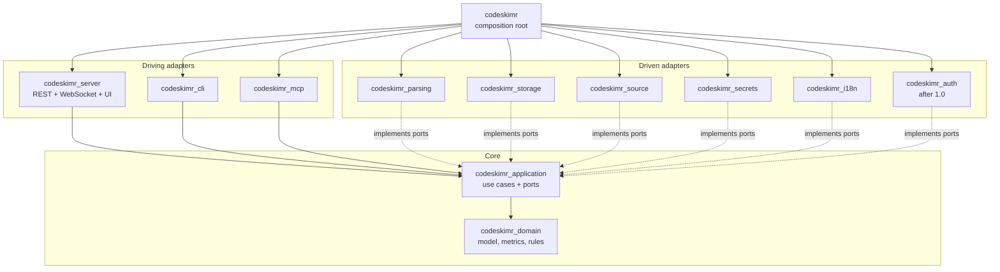
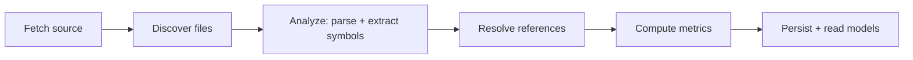

# CodeSkimr – Blueprint

|  |  |
|---|---|
| Version | 1.0 (draft for approval) |
| Date | 2026-11-13 |
| Product | CodeSkimr – fast, multi-language code documentation and code intelligence |
| Architect / Project lead | Product owner (human) |
| Implementation | Claude (code agents) |
| Binding UI reference | [UI mocks](https://claude.ai/artifact/FRpzF7hdgZVdHCm2mxRuNZ) · sources in `docs/mocks/` |

**Keywords.** **MUST** is mandatory. **SHOULD** is the normal case; any deviation is justified in the PR. **MAY** is optional.

**Language.** Code, identifiers, comments, commit messages and technical docs are English. The user interface ships in German and English from day one.

**How to use this document.** This blueprint is the single source of truth for the development project. Every rule here applies to every pull request. If a rule turns out to be wrong, change it here first (through an ADR, section 18.3); do not work around it in code.

---

## 1. Vision and scope

CodeSkimr scans code repositories, either a local folder or a Git repository, and turns them into navigable, interactive documentation. It covers types, members, metrics, dependencies and usages down to a single method or constant.

**Three audiences, one core:**

1. **Developers and architects** use the browser UI: explorer, dependency map, usages, quick search.
2. **Code agents** use the MCP server as a reference while they write code, so the code stays clean: they find existing functions, constants and conventions before adding new ones.
3. **Automation** uses the CLI and REST API: CI checks, exports.

**In scope for 1.0:**

- Local single-user application: one executable, local web server, UI in the browser. Every action already carries the caller's identity (a `Principal`, always the local owner in 1.0), so the team edition needs no signature changes (section 10.1, ADR 0019).
- Sources: local folders and Git repositories (clone, branch, update).
- Languages:
  - Full tier for C#, TypeScript/JavaScript, Python, Java, Kotlin and Rust. Go follows in the full tier after 1.0 (ADR 0011); in 1.0 it has the basic tier.
  - Basic tier for every language with a Tree-sitter grammar.
- Explorer, dependency map, usages per symbol, quick search, scan and performance view.
- MCP server (stdio and HTTP).
- Export as a single self-contained HTML file.
- UI in German and English.

**Out of scope for 1.0, but already designed so it can be added without rework:**

- Team server with multiple users, login (OIDC and local accounts), roles and project permissions, delivered in stages T1 to T3 (ADR 0019). Only the caller-identity seam is part of 1.0.
- Encrypted team vault for credentials (section 12.5).
- Compiler-precise reference resolution through SCIP or Roslyn (section 9.3).
- Top-league analysis depth in every supported language, C# first (section 9.5, ADR 0034).
- WASM analysis plugins.
- Snapshot comparison ("what changed between two releases").

---

## 2. Guiding principles

1. **Performance first.** Every interaction has a time budget (section 16). A feature that breaks a budget is not done.
2. **Lean and clear.** Short mouse paths, everything reachable by keyboard, no modal detours. Less code is better code.
3. **Single source of truth.** Every fact lives in exactly one place: data model, error codes, texts, constants, commands. Anything else is generated from it.
4. **Correct by construction.** Use the Rust type system and the crate boundaries so that wrong code does not compile. Prefer that over conventions.
5. **Clean Code and Green Code.** Readable, small, tested, and only compute what has changed.
6. **Careful with secrets.** Credentials live in memory only as long as they are needed (section 12).
7. **Honest output.** Every heuristic result shows its confidence. Nothing is invented: unknown stays unknown.

---

## 3. Binding code rules

All rules in this section are **MUST** and are enforced in CI (section 17.3).

### 3.1 Structure

- **R-01 No duplication.** Any block of logic that is needed more than once MUST be a function, trait or generic. CI runs a duplicate detector with zero tolerance (threshold: 5 lines / 50 tokens).
- **R-02 Small functions.** At most 40 lines per function, cognitive complexity at most 15, at most 5 parameters. Above that, use a parameter struct.
- **R-03 One concept per module.** Modules are named after domain concepts (`symbol`, `reference`, `snapshot`), never after technical buckets (`utils`, `helpers`, `misc`, `common`).
- **R-04 Dependency direction.** Dependencies follow section 4.2. Cycles between modules are forbidden.
- **R-05 No global mutable state.** No `static mut`, no lazily initialised mutable singletons. Dependencies are passed in through the composition root (section 5).

### 3.2 No literals

- **R-06** Production code MUST NOT contain literals. This applies to numbers, strings, characters, byte strings, durations and paths.
- **Allowed exceptions:**
  - The integers `0` and `1`.
  - Literals in test code (`#[cfg(test)]`, `tests/`, `*.test.ts`, `*.spec.ts`, benchmark data).
  - The value side of a `const` or `static` definition in a `consts.rs` module (Rust) or `consts.ts` (TypeScript).
  - Build scripts that generate code.
- **Where values live instead:**

| Kind of value | Location |
|---|---|
| Technical constant (buffer size, protocol name, header, file extension) | `consts.rs` of the owning crate / `consts.ts` of the owning feature |
| Tunable value (thresholds, budgets, limits, timeouts) | `config/default.toml` → typed config struct (section 14) |
| User-visible text (UI, CLI, error messages) | `locales/<lang>/*.ftl` → generated key constants (section 13) |
| Error codes and descriptions | `errors/error-codes.toml` → generated enum (section 11) |
| Language knowledge (queries, keywords, comment syntax) | `languages/<lang>/` (section 8) |
| Design tokens (colours, sizes, fonts) | `web/src/theme/tokens.ts`, generated from `design/tokens.toml` (section 15.3) |

- **Enforcement:**
  - Rust: a custom Dylint lint `no_literals`, in `tools/lints/`.
  - TypeScript: ESLint `no-magic-numbers` plus `i18next/no-literal-string`, configured with the same exceptions.

### 3.3 Correctness

- **R-07 No panics in production code.** `unwrap`, `expect`, `panic!`, `todo!`, `unimplemented!` and indexing without a bounds check are forbidden (Clippy `deny`). Errors are typed (section 11).
- **R-08 No `unsafe`** outside `codeskimr_secrets::memory` (section 12.4). Every `unsafe` block carries a `// SAFETY:` comment and a test.
- **R-09 Every public item is documented** (`missing_docs = deny`) in English, with one sentence of purpose and its errors where it has any.
- **R-10 Strict typing.** Rust: newtypes for IDs and validated values. TypeScript: `strict: true`, no `any`, no non-null assertions.

### 3.4 Style

- **R-11** `rustfmt` and `prettier` with the configuration files in the repo. Formatting is never discussed in reviews.
- **R-12** Naming: Rust follows the standard (`snake_case`, `UpperCamelCase`); TypeScript uses `camelCase` and `PascalCase` for components and types. Names are full words; abbreviations only where they are domain terms (`loc`, `cc`, `mi`).
- **R-13** Comments explain **why**, not **what**. Commented-out code is forbidden.

---

## 4. Architecture

### 4.1 Style: hexagonal (ports and adapters)

The domain core knows nothing about databases, file systems, networks, Tree-sitter or HTTP. It defines **ports** (Rust traits). **Adapters** implement them. **Driving adapters** (UI server, CLI, MCP) call the application layer with the identity of the caller (a `Principal`, section 10.1); **driven adapters** (storage, parsing, source, secrets, i18n, and after 1.0 auth) are called by it.

Every layer is its **own crate**. The compiler therefore enforces the dependency direction: if a crate imports something it may not use, the build fails.



### 4.2 Repository layout and namespaces

```
codeskimr/
├─ Cargo.toml                  workspace, shared lint configuration
├─ BLUEPRINT.md                this document
├─ crates/
│  ├─ domain/                  codeskimr_domain
│  │  └─ src/{symbol,member,reference,snapshot,project,metrics,layer,language,access,ids,consts,error}.rs
│  ├─ application/             codeskimr_application
│  │  └─ src/{ports/, commands/, queries/, pipeline/, events/, registry/, access.rs, consts.rs, error.rs}
│  ├─ adapters/
│  │  ├─ parsing/              codeskimr_parsing       Tree-sitter, language-pack interpreter
│  │  ├─ storage/              codeskimr_storage       SQLite, read models, search index
│  │  ├─ source/               codeskimr_source        file system, Git, file watcher
│  │  ├─ secrets/              codeskimr_secrets       credential store, vault (later)
│  │  ├─ auth/                 codeskimr_auth          users, login, tokens (after 1.0, ADR 0019)
│  │  └─ i18n/                 codeskimr_i18n          Fluent bundles
│  ├─ server/                  codeskimr_server        axum: REST, WebSocket, embedded UI
│  ├─ cli/                     codeskimr_cli           clap
│  ├─ mcp/                     codeskimr_mcp           rmcp: stdio + streamable HTTP
│  ├─ codes/                   codeskimr_codes         generated: error codes, i18n keys
│  └─ app/                     codeskimr (binary)      composition root, main.rs
├─ web/                        frontend (TypeScript)
│  └─ src/{app/, features/{projects,explorer,graph,usages,palette,scan}/, shared/{api,ui,i18n,theme}/}
├─ languages/<lang>/           language packs (section 8)
├─ locales/{de,en}/            Fluent files (section 13)
├─ errors/error-codes.toml     central error code registry (section 11)
├─ config/default.toml         tunable values (section 14)
├─ design/tokens.toml          design tokens (section 15.3)
├─ corpus/                     test repositories and expected results (section 17.2)
├─ tools/{lints/,codegen/,bench/}
└─ docs/{adr/, mocks/, architecture.md}
```

**Allowed dependencies (MUST, checked by CI):**

| Crate | May depend on |
|---|---|
| `domain` | `codes`, std, `thiserror` |
| `application` | `domain`, `codes` |
| `parsing`, `storage`, `source`, `i18n` | `application`, `domain`, `codes` |
| `secrets` | `application`, `domain`, `codes` – and **no** other adapter |
| `auth` (after 1.0) | `application`, `domain`, `codes` – and **no** other adapter; password hashing and OIDC libraries stay inside it |
| `server`, `cli` | `application`, `domain`, `codes`, `i18n` |
| `mcp` | `application`, `domain`, `codes`, `i18n` – **never** `secrets` |
| `app` (binary) | everything; the only place where adapters are wired |

### 4.3 Runtime model

- **One process.** `codeskimr` starts the local server, opens the browser and keeps the index in memory. `codeskimr mcp` and `codeskimr scan` reuse a running instance if there is one; otherwise they run standalone.
- **Async for I/O** (Tokio): HTTP, WebSocket, Git, file watching, database.
- **Parallel for CPU** (Rayon): parsing, resolving, metrics. CPU work never blocks the async runtime; the boundary is a dedicated pool.
- **Bind address:** `127.0.0.1` only in 1.0. Remote access exists only in the team server's server mode, with TLS or a trusted reverse proxy (ADR 0019, S-04). Server mode is chosen at start and cannot be switched at runtime.
- **Caller identity:** the composition root resolves the `Principal` once (single-user: the local owner; team server: from the request's credentials through the `Authenticator`). Adapters receive it and never create one.

### 4.4 Technology stack

| Concern | Choice | Reason |
|---|---|---|
| Language (core) | Rust, stable, edition 2024 | speed, safety, single binary |
| Parsing | `tree-sitter` + grammar crates | 150+ languages, error-tolerant |
| Parallelism | `rayon` | data parallelism without boilerplate |
| Async / HTTP | `tokio`, `axum` | standard, fast |
| Storage | SQLite via `rusqlite` (WAL mode) | embedded, zero setup; PostgreSQL later for the team server |
| Fuzzy search | `nucleo` | fast, used in production editors |
| File walking | `ignore` | `.gitignore`-aware, parallel |
| Git | `gix` | pure Rust |
| File watching | `notify` | OS events, no polling |
| Hashing | `blake3` | fast content hashes for incremental scans |
| CLI | `clap` | standard |
| MCP | `rmcp` (official Rust SDK) | protocol compliance |
| OpenAPI | `utoipa` | generates the TypeScript API client |
| i18n | `fluent-bundle`, `icu4x` | shared `.ftl` files with the frontend |
| Secrets | `keyring-core` with the native stores, `secrecy`, `zeroize`, `memsec` | section 12, ADR 0018 |
| Errors | `thiserror` | typed errors per crate |
| Logging | `tracing` | structured, with secret redaction |
| Frontend | TypeScript, **SolidJS**, Vite | fine-grained reactivity, small bundle (ADR 0028) |
| Frontend virtualisation | `@tanstack/solid-virtual` | trees and tables with 100k rows |
| Graph drawing | Canvas 2D (WebGL above 2,000 nodes); layout computed in Rust | fast, lean frontend |
| E2E tests | Playwright | UI behaviour and visual comparison |

---

## 5. Design patterns

| Pattern | Where | Rule |
|---|---|---|
| **Ports and adapters / dependency inversion** | all crates | The core only knows traits. Adapters implement them. |
| **Composition root** | `crates/app/src/main.rs` | The only place where concrete adapters are created and wired. No service locator, no singletons. |
| **Pipes and filters** | scan pipeline (section 7) | Each stage implements `Stage`; stages are independent and testable on their own. |
| **Interpreter (data-driven)** | language packs (section 8) | Language knowledge is data. One interpreter serves all languages. No per-language Rust code for the basic tier beyond one grammar registration (ADR 0020). |
| **Strategy** | reference resolution, exporters, metrics | Interchangeable behind a trait, chosen by configuration. |
| **Registry** | languages, commands, exporters, analyses, MCP tools | Extensions register themselves; the core looks them up by key. |
| **Command** | all user actions | **One** command registry feeds the quick search, keyboard shortcuts, CLI, REST and MCP. Each action is implemented exactly once. |
| **CQRS (light)** | storage | The scan writes the model; queries read precomputed read models (`usage_counts`, `search_index`, `layer_graph`). |
| **Repository + unit of work** | storage | One snapshot is written atomically or not at all. |
| **Observer / event bus** | progress, changes | Domain events (`ScanProgressed`, `SnapshotCreated`, `FilesChanged`) are published once; WebSocket, CLI and MCP subscribe. |
| **Newtype** | IDs and validated values | `SymbolId`, `FileId`, `ProjectId`, `ErrorCode`, `Loc` … can never be mixed up. |
| **Typestate** | scan job, credential lifecycle | Invalid transitions do not compile (e.g. `Job<Queued>` → `Job<Running>` → `Job<Finished>`). |
| **Loan pattern** | credentials (section 12) | A secret only exists inside a closure. |
| **Builder** | complex value construction (queries, configs) | No constructors with more than 5 parameters (R-02). |

**Generated, never hand-written:**

- TypeScript API types and client, from OpenAPI.
- Error code enum and constants, from `errors/error-codes.toml`.
- i18n key constants for Rust and TypeScript, from `locales/en/*.ftl`.
- Design tokens for TypeScript and CSS, from `design/tokens.toml`.

---

## 6. Domain model and storage

### 6.1 Core entities

| Entity | Meaning | Key fields |
|---|---|---|
| `Project` | registered repository | id, name, source (folder \| git url + branch), layers, settings |
| `Snapshot` | one scan state | id, project, commit (if Git), created, mode (full \| incremental), stats |
| `File` | source file | id, snapshot, path, language, content hash, loc |
| `Symbol` | anything with a name | id, file, kind, name, qualified name, parent symbol, visibility, static, span, signature, doc |
| `Reference` | one occurrence of a symbol | id, from symbol, to symbol, file, span, kind, confidence |
| `Metric` | measured value | symbol, kind (loc, cc, cc_max, mi, ce, ca, instability), value |
| `LayerEdge` | aggregated dependency between namespaces / layers | from, to, count, violates layering, part of cycle |

**Symbol kinds** are language-neutral: `module`, `namespace`, `class`, `interface`, `trait`, `record`, `struct`, `enum`, `union`, `function`, `method`, `constructor`, `property`, `field`, `constant`, `event`, `enum_member`, `parameter`, `type_alias`. Language packs map their syntax onto these kinds. Free functions belong to a `module` symbol, one per file.

**Metric granularity (ADR 0015).** LOC, CC and MI are measured per callable (`function`, `method`, `constructor`) and rolled up to types and modules: LOC counts the code lines of the span, CC sums over the callables, `cc_max` is the highest callable CC, MI is the LOC-weighted mean of the callables. A lambda counts for its enclosing callable; a named local function counts for itself. CC is 1 plus one per `if`/`else if`, conditional expression, loop, case or match arm, `catch` and short-circuit operator. MI uses Halstead counts of operators and operands (distinct and total) that the language pack captures per callable. Thresholds apply to callable CC and `cc_max`, not to sums. Details and counting rules: ADR 0015.

**Reference kinds:** `call`, `read`, `write`, `type_use`, `inherit`, `implement`, `override`, `import`, `test`.

**Confidence:** `certain` | `probable`. The UI and MCP always show it (section 9).

### 6.2 Storage

- One SQLite database per workspace, in the user data directory. The source code itself is **not** copied; the file is read on demand and checked against its hash.
- **Read models**, rebuilt incrementally after every snapshot:
  - `search_index` – fuzzy search entries for the quick search
  - `usage_counts` – the "Usages" column
  - `layer_graph` – the dependency map
  - `type_summary` – the metric strip
- **Retention:** keep the last N snapshots per project (configurable, default from `config/default.toml`).
- Schema migrations are versioned SQL files in `crates/adapters/storage/migrations/`, applied at start-up.

---

## 7. Analysis pipeline



| Stage | Responsibility | Parallel |
|---|---|---|
| Fetch source | folder: nothing to do; Git: shallow clone or fetch | I/O |
| Discover files | walk with `.gitignore`, detect language, hash content, skip unchanged files | yes |
| Analyze | Tree-sitter per file, then run the language-pack queries and build symbols and members; the tree never leaves the adapter (ADR 0013) | yes (per file) |
| Resolve references | map names to symbols (section 9) | yes (per file, after a global symbol table pass) |
| Compute metrics | LOC, CC, MI, Ce, Ca, instability | yes |
| Persist | one transaction per snapshot, then update read models | single writer |

**Rules:**

- **Incremental by default.** Only files whose hash changed are processed. Dependent references are re-resolved through the reverse index.
- **Streaming results.** The UI can already show finished parts while the scan runs (mock 5).
- **Cancellable** at every stage boundary, without leaving a partial snapshot behind.
- **Watch mode:** file-system events are debounced; the incremental re-scan budget is < 300 ms (section 16).

---

## 8. Language packs

### 8.1 Format

```
languages/csharp/
├─ language.toml      metadata and rules
├─ symbols.scm        Tree-sitter query: declarations → symbol kinds
├─ references.scm     Tree-sitter query: identifiers, calls, imports, scopes
├─ metrics.scm        Tree-sitter query: comments, decision points, Halstead operators and operands
├─ highlights.scm     syntax highlighting for the UI
└─ tests/             small sample files + expected JSON (golden tests)
```

`language.toml` contains, among other things:

- file extensions
- the grammar (built in, or a dynamically loaded library)
- doc-comment syntax and how to extract the summary
- visibility keywords and defaults
- project manifest files (`*.csproj`, `package.json`, `pom.xml`, `go.mod`, `Cargo.toml`, `pyproject.toml` …)
- test file patterns
- the tier (`full` | `basic`)

### 8.2 Tiers

| Tier | Delivers | Languages in 1.0 |
|---|---|---|
| **full** | symbols incl. members, doc comments, references with scope-aware resolution, all metrics | C#, TypeScript/JavaScript, Python, Java, Kotlin, Rust (Go after 1.0, ADR 0011) |
| **basic** | types and functions, spans, LOC, CC, `cc_max` (no MI); references only by unique name | every other language with a Tree-sitter grammar |

- Full-tier grammars are compiled into the binary.
- Basic-tier grammars are compiled in behind the cargo feature `basic-grammars` (default on) and their packs are loaded on first use, which keeps start-up and a slim build small (section 16, ADR 0020). A loader for shared libraries needs its own ADR because of R-08.
- Adding a language MUST NOT require changes outside `languages/<lang>/`, unless the language needs a new symbol kind (ADR first) or, as long as grammars are compiled in, its grammar: one dependency, one grammar name constant and one line in the grammar registry of `codeskimr_parsing` (ADR 0020).

### 8.3 Acceptance per language

A language counts as supported when its golden tests pass and the corpus project for that language meets the accuracy targets in section 17.2.

---

## 9. Reference index and usages

### 9.1 Purpose

The reference index answers, for any symbol (method, constant, property, type):

- **Who uses it?** (callers, readers, writers, implementers)
- **What does it use?**
- **What breaks if it changes?** (impact)

It powers mock 6 (Usages), the "Usages" column in the explorer, `find_usages` and `impact_of_change` in MCP.

### 9.2 Level 1 – own resolution (1.0, all languages)

Name resolution is based on Tree-sitter, in this order:

1. Local scopes and parameters.
2. Members of the enclosing type and its known base types.
3. The receiver's declared type, where it is visible in the syntax (`var x: Foo`, `new Foo()`, field types).
4. Imports and namespaces.
5. Global unique name.

- A reference resolved through steps 1–4 is `certain`.
- A reference resolved through step 5, through an interface or base-class dispatch, or with several candidates is `probable`. It points to all candidates.
- **Level 1 never drops a candidate** (ADR 0033). A name that matches members of unrelated types is reported for all of them, as `probable`. A missing usage makes an impact analysis worthless, so recall ranks above precision here; level 1 makes up for it by marking what it found as unchecked (section 9.4).

### 9.3 Level 2 – compiler-precise (after 1.0, optional)

Import SCIP indexes produced by existing indexers (e.g. for TypeScript, Java/Kotlin, Python) and Roslyn for C#. Imported references replace level-1 references for the same span and are always `certain`. This is a `ReferenceResolver` strategy (section 5); no other component changes.

### 9.4 Rules

- Every reference stores its confidence. UI and MCP MUST show `probable` references visibly (dashed edge, label).
- Every reference stores `verified`: `true` only if level 2 produced it, `false` for every level-1 reference. `find_usages`, `impact_of_change`, REST and UI count verified and unchecked results separately, list verified ones first, and call an analysis **preliminary** while any result of it is unchecked. An impact symbol is verified only if a path of verified references leads to it.
- Usage counts and the reverse index are updated incrementally together with the snapshot.

### 9.5 Depth goal after 1.0

In later versions CodeSkimr is to play in the top league in every language it supports, that is to reach the analysis depth of the best specialised tools of that language (for C# the yardstick is NDepend): semantic facts such as overloads and generics, member-level dependencies, wider metrics, rules over the code model, and comparison of snapshots. It climbs a depth ladder (D1 to D6) one language at a time, C# first, without changing 1.0. The ladder, the rough work packages and the guard rails are in ADR 0034.

---

## 10. Interfaces: commands, CLI, REST, WebSocket, MCP

### 10.1 Command registry (single source)

Every user-facing action is a `Command` with:

- an id (constant)
- an i18n key for its title and description
- input and output types
- a default keyboard shortcut (optional)
- a flag saying whether it is read-only
- the `Permission` a caller needs (`read`, `read_source`, `scan`, `manage`, `register_project`, `admin`)

The registry generates:

- quick-search entries and keyboard shortcuts (UI)
- CLI sub-commands
- REST endpoints (OpenAPI)
- MCP tools

**No action is implemented twice.**

**Caller identity and permissions (MUST, ADR 0019):**

- `Principal` and `Permission` are pure types in `codeskimr_domain`. In 1.0 the only principal is `LocalOwner`, who holds every permission; it is created only in the single-user composition root (a test enforces this). A principal with fewer permissions is built only by an authenticator or in tests.
- Every command and every use case receives the `Principal` inside its request or context struct (so the parameter limit R-02 holds). Commands run only through `Registry::execute`, which checks the declared permission once, before the command starts; the registry hands out no handler that could skip the check. Registering a command fails if its read-only flag contradicts its permission (a read-only command needs `read` or `read_source`, any other command needs something else). Use cases that are not commands yet (the scanner, the MCP tools) call `access::require` first, before they read anything or validate arguments.
- Denial gives the registered error `AUTH-401` and names neither the permission nor a project; "not found" and "not allowed" must not become an oracle. A denied scan starts nothing and publishes no event.
- Any source text a command, route, tool or export returns needs `read_source`.

### 10.2 CLI

```
codeskimr                         start the app, open the browser
codeskimr scan <path|git-url>     scan and print a summary (--json for machines, --watch to keep scanning on changes)
codeskimr serve                   start the server without opening a browser
codeskimr mcp                     MCP over stdio
codeskimr export <project> --html <file>
codeskimr check <path>            run the convention checks (for CI)
codeskimr codes [<code>]          list error codes / explain one code
```

The local commands run as the local owner without login. After 1.0 the team edition adds `codeskimr serve --team`, `login --server <url>`, `user …` and `token …` (ADR 0019); local commands keep working without login.

### 10.3 REST and WebSocket

- **REST** under `/api/v1`, described by OpenAPI (generated by `utoipa`). The TypeScript client is generated from it.
- **WebSocket** at `/api/v1/events` streams domain events: scan progress, snapshot created, files changed.
- Every error response carries the error code (section 11).
- **Token for the UI:** the browser UI obtains the installation token through a one-time launch code in the URL fragment, exchanged once at `/api/v1/session/exchange` and kept in `sessionStorage` (ADR 0028). The token is never embedded in served pages.
- Every route resolves a `Principal` before it calls the application layer. In single-user mode that is the local owner; in server mode it comes from the session cookie or a personal access token (ADR 0019).

### 10.4 MCP server

- **Transports:**
  - stdio: `codeskimr mcp`, for Claude Code, Cursor and similar tools.
  - Streamable HTTP at `/mcp`, when the app is running. The agent then shares the in-memory index; nothing is scanned twice.
- **Purpose:** to be a code agent's reference during development, so that it **reuses instead of duplicating** and **follows the architecture instead of guessing**.

| Tool | Input | Output (compact) |
|---|---|---|
| `search_symbols` | query, kind?, project?, limit | ranked symbols with location |
| `get_symbol` | symbol id or qualified name | signature, doc, members, metrics, layer |
| `find_usages` | symbol, direction, depth, include_tests | references with kind, location, confidence |
| `impact_of_change` | symbol | affected symbols, layers, public interfaces |
| `get_dependencies` | symbol or namespace, direction | edges with counts and violations |
| `find_similar_code` | code snippet or symbol | existing functions with similar structure ("does this already exist?") |
| `find_constants` | query | existing constants, config keys and i18n keys |
| `get_architecture` | project | layers, allowed dependencies, namespace map, conventions |
| `get_project` | project? | languages, and per tool of level 2 its state (ready, missing, too old, version unknown) with purpose and install hint (ADR 0033, decision 8) |
| `check_conventions` | paths or diff | violations of section 3 (duplicates, literals, layering, length, complexity) with error codes |
| `rescan` | paths? | incremental update, returns the new snapshot id |

**Resources:** `codeskimr://<project>/architecture`, `codeskimr://<project>/conventions`, `codeskimr://<project>/errors`.

**Rules:**

- Read-only by default; `rescan` is the only tool with a side effect.
- stdio is single-user and local and runs as the local owner. Streamable HTTP is bound to `127.0.0.1` and requires a per-installation token in 1.0; in the team edition it requires a personal access token, and tools and resources see only the projects granted to that token's principal (ADR 0019).
- Every tool declares the permission it needs (all current tools: `read`) and checks it before reading anything.
- Access only to registered projects (in the team edition: only granted ones).
- No access to credentials at all (crate rule in 4.2).
- Responses are token-efficient: paginated, with fixed limits from config, and they state the snapshot id and its age.
- `find_similar_code` uses normalised syntax-tree fingerprints (identifiers and literals abstracted, winnowing). It shares this logic with the duplicate check in `check_conventions`; there is one implementation.

---

## 11. Errors and error codes

### 11.1 Principles

- Every error that can leave a crate boundary has an **error code**. This covers Rust errors, frontend exceptions, CLI exit messages, REST responses and MCP errors.
- All codes live in **one central file**: `errors/error-codes.toml`. It is the single source of truth.
- Codes are grouped by **prefix**. Inside a group, the hundreds digit classifies the error.
- Codes are **never reused or renumbered**. A retired code is marked `deprecated = true` and stays in the file.

### 11.2 Code format

```
<PREFIX>-<C><NN>     e.g.  SRC-201, SEC-402, MCP-101
```

| Part | Meaning |
|---|---|
| `PREFIX` | group, 2–4 upper-case letters (table 11.3) |
| `C` | class (table below) |
| `NN` | sequence within group and class, `01`–`99` |

| Class `C` | Meaning |
|---|---|
| `1` | invalid input / validation |
| `2` | not found / unavailable |
| `3` | conflict / invalid state |
| `4` | authentication / permission (`AUTH-401` permission denied; `API-401` installation token) |
| `5` | limit / timeout / resources |
| `6` | external system failed (Git host, OS, network) |
| `9` | internal error (bug) |

### 11.3 Groups

| Prefix | Group | Crate / area |
|---|---|---|
| `APP` | application start, lifecycle | `app` |
| `CFG` | configuration | `app`, `application` |
| `PRJ` | projects and snapshots | `application`, `storage` |
| `SRC` | sources: file system, Git, watcher | `source` |
| `PRS` | parsing and language packs | `parsing` |
| `RES` | reference resolution | `parsing`, `application` |
| `IDX` | search and read models | `storage` |
| `STO` | persistence | `storage` |
| `SEC` | credentials and security | `secrets` |
| `NET` | network and platforms (GitHub, GitLab …) | `source`, `secrets` |
| `AUTH` | caller identity, permissions, later login and tokens | `application`, later `auth` |
| `API` | REST and WebSocket | `server` |
| `MCP` | MCP server | `mcp` |
| `CLI` | command line | `cli` |
| `I18N` | translations | `i18n` |
| `EXP` | export | `application` |
| `UI` | frontend | `web` |
| `CHK` | convention-check findings (not failures, see 11.6) | `application` |

### 11.4 Central file format

```
# errors/error-codes.toml – single source of truth for all error codes.

[groups.SRC]
title = "Sources: file system, Git, watcher"
crate = "codeskimr_source"

[[codes]]
id = "SRC-201"
name = "source_path_not_found"          # → ErrorCode::SourcePathNotFound
severity = "error"                      # error | warning | info
retryable = false
description = "The configured source folder does not exist or is not readable."
since = "0.1.0"

[[codes]]
id = "SRC-601"
name = "git_fetch_failed"
severity = "error"
retryable = true
description = "Fetching from the Git remote failed (network or remote error)."
since = "0.1.0"
```

- `description` is the English developer description (for logs, docs and `codeskimr codes`).
- The **user-facing message** is a Fluent entry `error-<id>` in `locales/<lang>/errors.ftl`, e.g. `error-SRC-201 = Der Ordner { $path } existiert nicht.` It may use parameters; it never contains secrets.

### 11.5 Code generation and usage

`tools/codegen` (run by `build.rs` in `codeskimr_codes`) generates:

- Rust: `enum ErrorCode { SourcePathNotFound, … }` with `id()`, `group()`, `class()`, `severity()`, `retryable()`, `description()`, `message_key()`.
- TypeScript: `ErrorCode` union and lookup table.
- `docs/error-codes.md`: the readable catalogue.

Every crate defines its own `thiserror` enum. Each variant maps to exactly one `ErrorCode`:

```
#[derive(Debug, thiserror::Error)]
pub enum SourceError {
    #[error("{}", ErrorCode::SourcePathNotFound.description())]
    PathNotFound { path: SourcePath },
    #[error("{}", ErrorCode::GitFetchFailed.description())]
    GitFetchFailed { remote: RemoteName, #[source] cause: GitCause },
}

impl Coded for SourceError {
    fn code(&self) -> ErrorCode {
        match self {
            Self::PathNotFound { .. } => ErrorCode::SourcePathNotFound,
            Self::GitFetchFailed { .. } => ErrorCode::GitFetchFailed,
        }
    }
}
```

**Where the code appears:**

| Surface | Representation |
|---|---|
| Logs | `code=SRC-201` as a structured field, always |
| REST | `{ "code": "SRC-201", "message": "<localised>", "params": {…}, "retryable": false }` |
| MCP | tool error with `code`, English `description` and `params` |
| CLI | `error[SRC-201]: <localised message>`; `codeskimr codes SRC-201` explains it |
| UI | localised message, the code in small monospace, button "Copy details" |

### 11.6 Rules

- **E-01** New error → new entry in `error-codes.toml` + Fluent message in `de` and `en`, in the same PR.
- **E-02** CI fails on duplicate ids, ids that do not match the format, unused codes, codes without messages in all languages, and code variants without a mapping.
- **E-03** Frontend exceptions are caught at feature boundaries and converted into a coded `AppError` (`UI-9xx` for unexpected ones). An uncaught exception is a bug.
- **E-04** `CHK` codes are findings of `check_conventions` (e.g. `CHK-101` literal found, `CHK-102` duplicate block). They use the same registry so that agents and CI speak the same language.
- **E-05** Errors never contain secrets, tokens or full credential-bearing URLs (section 12.6).

---

## 12. Credentials and security

### 12.1 Goal

Handle credentials as carefully as is technically possible. CodeSkimr cannot control what the operating system or third-party libraries do internally. Within its own code it follows the rules below without exception.

### 12.2 Preference order (MUST)

1. **Store nothing.** For Git, use the system's Git credential helper.
2. **Tokens instead of passwords.** For GitHub and GitLab, use the OAuth device flow with minimal scopes and short-lived tokens.
3. **OS keystore** for anything that must be stored: Windows Credential Manager (DPAPI), macOS Keychain, Linux Secret Service, via `keyring-core` and the native stores (ADR 0018).
4. **Never** in SQLite, config files, environment dumps, logs or exports. The database only stores a `CredentialId`.

### 12.3 Lifetime in memory (MUST)

- A credential is read **immediately before** each login attempt and wiped **immediately after** it.
- **Every retry reads again and wipes again.** Nothing is cached between attempts.
- This is enforced with the **loan pattern**: the secret only exists inside a closure, and the borrow checker forbids it from leaving.

```
/// Not Clone, not Debug, not Serialize. Memory is zeroed on drop.
#[derive(ZeroizeOnDrop)]
pub struct Credential {
    user: SecretString,
    secret: SecretString,
}

pub trait CredentialStore {
    /// Reads the credential, lends it to `action`, wipes it afterwards.
    fn with_credential<T>(
        &self,
        id: &CredentialId,
        action: impl FnOnce(&Credential) -> Result<T, AuthError>,
    ) -> Result<T, AuthError>;
}

/// Each attempt reads and wipes again – never hoisted out of the loop.
fn login_with_retry(store: &impl CredentialStore, client: &impl LoginClient, id: &CredentialId, policy: &RetryPolicy)
    -> Result<Session, AuthError>
{
    policy.run(|| store.with_credential(id, |credential| client.login(credential)))
}
```

### 12.4 Memory hardening

- Secret buffers are locked against swapping (`VirtualLock` / `mlock` via `memsec`) and zeroed on drop (`zeroize`).
- Core dumps / Windows error-report memory dumps are disabled for the process.
- Secrets are never `format!`ed, never logged and never sent over IPC. `SecretString` only exposes its content through an explicit, greppable `expose_secret()` call. CI lists every call site, and each one needs reviewer approval.
- `unsafe` for memory locking lives only in `codeskimr_secrets::memory` (R-08).

### 12.5 Team vault (designed now, built after 1.0)

- **Port:** `SecretVault` with `store`, `with_secret` (loan pattern), `rotate`, `delete`, `list_ids`. `CredentialStore` for 1.0 is the OS-keystore adapter of the same port family. Switching to the vault changes only the composition root.
- **Encryption:** envelope encryption.
  - One data key per secret, XChaCha20-Poly1305.
  - Data keys wrapped by a master key held in the OS keystore, an HSM or a cloud KMS.
  - Associated data binds each ciphertext to project id and credential id; the binding must survive project deletion and id reuse (no re-binding of ciphertext to a reused id). The owning grant is an access check, not part of the key (ADR 0019, stage T3).
- **Storage:** separate table or file, never in the analysis database. Optimistic versioning and audit entries (who used which credential when; never the value). A maintainer can use only credentials explicitly assigned to that project.
- **Rotation:** master-key rotation re-wraps data keys without decrypting secrets in bulk.

### 12.6 Rules and tests

- **S-01** Logs are filtered through a redaction layer: token patterns (including the `csk_` access-token prefix), `Authorization` and `Cookie`/`Set-Cookie` headers, OIDC `code`, `state` and `id_token`, and URL user-info are masked.
- **S-02** A test suite runs logins, failures and panics with canary secrets and asserts that the canary never appears in logs, error messages, REST/MCP responses, crash output or the database file.
- **S-03** Dependency audit (`cargo-audit`, `cargo-deny`) in every CI run; a known vulnerability blocks the merge.
- **S-04** In single-user mode, server and MCP bind to `127.0.0.1` and HTTP endpoints that change state require the per-installation token. Non-loopback binding is allowed only in the team server's server mode and only with TLS configured or behind a configured trusted reverse proxy; otherwise start fails with a registered error code. `X-Forwarded-*` is accepted only from trusted peers. CORS is closed; Host and Origin are validated (DNS rebinding). The one exception to the token rule is the exchange of the one-time launch code for the token (`/api/v1/session/exchange`, ADR 0028): it needs a valid, unused code that lives 60 seconds, and `Host` and `Origin` are still checked. Pages are served with a strict Content-Security-Policy (no inline scripts).
- **S-05** Paths from API/MCP input are canonicalised and checked against registered project roots (no path traversal). In the team edition the check also covers the caller's grant, and registrable roots and clone URLs follow a server-side allow-list (path traversal, SSRF).
- **S-06** Authorisation lives once, in the registry check (10.1). Adapters never decide. Tests cover every command with a restricted principal; for the team edition each route, WebSocket message, CLI command and MCP tool is tested with each role and with "no grant", and denial and "not found" are compared for identical responses. The canary suite (S-02) also scans the identity database.

---

## 13. Internationalisation

- **Format:** Project Fluent (`.ftl`), shared by backend (CLI, errors, MCP texts) and frontend.
- **Files:** `locales/{de,en}/{app,explorer,graph,usages,palette,scan,projects,errors,cli}.ftl`.
- **Generated keys:** `tools/codegen` generates key constants for Rust (`codeskimr_codes::i18n`) and TypeScript (`shared/i18n/keys.ts`) from the English files. Code never contains a message string (R-06), and an unknown key does not compile.
- **Completeness:** CI fails if a key is missing in any language or exists in only one.
- **Formatting:** numbers, dates and durations through ICU4X / `Intl` per locale. In German, `0,90` and `1.667`, as in the mocks.
- **Language selection:** system language by default, switchable in the UI; the choice is stored per user. The theme (15.3) is stored the same way.
- **Adding a language** means adding a folder under `locales/`; no code changes.
- **Not translated:** identifiers from scanned code, file paths, error code ids.

---

## 14. Configuration and constants

- **`config/default.toml`** ships with the binary and holds every tunable value:
  - metric thresholds (CC ≤ 5 good, ≤ 10 medium; MI ≥ 55 good, ≥ 35 medium; instability ≤ 0.5 stable, ≤ 0.8 medium)
  - performance budgets (section 16)
  - MCP limits
  - snapshot retention
  - watcher debounce
  - excluded folders (`bin`, `obj`, `.git`, `node_modules`, `target`, `dist` …)
- **Overrides,** applied in this order: user config file → project config (`.codeskimr.toml` in the repository) → CLI flags.
- **Typed config:** the config is deserialised into typed structs and validated at start-up. Invalid values produce `CFG-1xx` errors. There is no `config.get("string")` anywhere in the code.
- **`consts.rs` / `consts.ts`:** technical constants that are not tunable. One file per crate or feature, never a global constants file.

---

## 15. User interface

### 15.1 Binding reference: the mocks

> **The goal is to match the mocks as closely as possible.** Layout, proportions, colours, fonts, spacing, labels, icons, keyboard hints and interactions follow the [UI mocks](https://claude.ai/artifact/FRpzF7hdgZVdHCm2mxRuNZ). Their sources are in `docs/mocks/` and contain the exact values. Deviations are only allowed where a mock shows sample data or where a behaviour is technically impossible, and each deviation MUST be listed in the PR with a screenshot. Changing the look intentionally means updating the mocks and this blueprint first.

The screens (details in Appendix B):

| # | Screen | Mock file |
|---|---|---|
| 1 | Projects | `docs/mocks/Main.dc.html` |
| 2 | Explorer | `docs/mocks/Explorer.dc.html` |
| 3 | Dependencies | `docs/mocks/Graph.dc.html` |
| 4 | Quick search (Ctrl+K) | `docs/mocks/Palette.dc.html` |
| 5 | Scan and performance | `docs/mocks/Scan.dc.html` |
| 6 | Usages (symbol level) | `docs/mocks/Usages.dc.html` |
| 7 | Sign-in (team server) | `docs/mocks/Login.dc.html` |
| 8 | Users and project grants | `docs/mocks/Users.dc.html` |
| 9 | Groups and roles | `docs/mocks/Roles.dc.html` |
| 10 | Access tokens | `docs/mocks/Tokens.dc.html` |
| 11 | Audit log | `docs/mocks/Audit.dc.html` |
| 12 | Single sign-on | `docs/mocks/Sso.dc.html` |
| 13 | Settings: themes and language | `docs/mocks/Themes.dc.html` |

Screens 7 to 12 belong to the team edition (after 1.0, ADR 0019, milestone T2) and exist as mocks so that the UI can be built to them; screen 13 belongs to 1.0 (ADR 0021). The mocks 7 to 13 take a `theme` property (15.3); mocks 1 to 6 are drawn in the theme Hell (layout binding, colours follow the active theme, see 15.3).

The mock sources are written in a design-canvas format; render them through the link above. Read the files for exact values (inline styles). All numbers and names in them are **sample data**.

### 15.2 Layout frame (all screens)

| Element | Size | Content |
|---|---|---|
| Top bar | height 48 px | logo + product name, project breadcrumb, branch / working-folder chip, search field opening the quick search (shows `Strg K` / `Ctrl K`); in team mode also server name and user menu |
| Navigation rail | width 56 px | Projects, Explorer, Dependencies, Scans & performance at the top; at the bottom Administration (admins in team mode only) and Settings; active item tinted |
| Status bar | height 28 px | live measurements (watch state, counts, last query time, memory), monospace |
| Explorer tree | width 290 px | filter, collapse all, show selection |
| Source pane | width 560 px (shrinks) | file path, member position, code |
| Side panel (graph, usages) | width 300–320 px | details of the selection |

Below 1,000 px width, columns stack; the page never scrolls horizontally (16 px gutter).

### 15.3 Design tokens

Defined once in `design/tokens.toml`. TypeScript/CSS variables are generated from it (section 5). Values taken from the first mocks (theme **Hell**; the other themes are in "Themes" below):

| Token | Value | Use |
|---|---|---|
| `bg` | `#F6F7F9` | page background |
| `surface` | `#FFFFFF` | panels, cards |
| `line` / `line-soft` | `#E3E6EB` / `#EEF0F3` | borders / row separators |
| `ink` / `ink-2` | `#14171C` / `#3A414C` | text / secondary text |
| `muted` / `faint` | `#5B6370` / `#6B7280` | labels / meta (both ≥ 4.5:1 on white) |
| `accent` / `accent-bg` / `accent-hover` | `#2457D6` / `#EAF0FD` / `#1A43A8` | selection, links, primary action, incoming edges |
| `outgoing` | `#C2410C` | "uses" edges |
| `good` / `good-bg` | `#15803D` / `#EAF7EF` | status OK, metric good |
| `warn` / `warn-bg` | `#B45309` / `#FFF4E5` | metric medium, attention |
| `bad` / `bad-bg` | `#B91C1C` / `#FDF2F2` | metric bad, violations |
| `highlight` / `mark` | `#FFF7D6` / `#FDE68A` | selected member lines / search hit, focus ring |
| kind colours | class `#2457D6`, interface `#7C3AED`, record `#0F766E`, struct `#B45309`, enum `#BE185D` | kind badges |
| layer colours | in `meta.layers` order: `#2457D6`, `#0F766E`, `#7C3AED`, `#B45309`, `#BE185D`, `#5B6370`, … | layer dots and bands |
| radius | 4 / 6 / 8 / 10 / 14 px | badge / button / card / panel / dialog |
| spacing | 4, 6, 8, 10, 12, 16, 24, 32 px | — |

**Typography:**

- Inter 13 px for body text, 11.5 px for meta, 22–24 px / 700 for headings.
- JetBrains Mono 12–12.5 px for code and names, 20 px line height, ligatures off (`font-variant-ligatures: none`).
- Fonts are **bundled with the app** (offline, no third-party requests).

#### Themes

The UI offers three themes in the first version (ADR 0021). Every theme defines every token in `design/tokens.toml`; the generated CSS variables are scoped by `data-theme`. Components use variables only.

| Token | Hell | Petrol (default) | Dunkel |
|---|---|---|---|
| `bg` | `#F6F7F9` | `#F4F6F8` | `#12171D` |
| `surface` | `#FFFFFF` | `#FFFFFF` | `#1A212A` |
| `line` / `line-soft` | `#E3E6EB` / `#EEF0F3` | `#DDE3EA` / `#E8EDF2` | `#2C3643` / `#232C37` |
| `ink` / `ink-2` | `#14171C` / `#3A414C` | `#1B2430` / `#3A4656` | `#E6EBF1` / `#C5CED9` |
| `muted` / `faint` | `#5B6370` / `#6B7280` | `#5D6B7C` / `#5F6E80` | `#97A4B4` / `#8996A6` |
| `accent` / `accent-bg` / `accent-hover` | `#2457D6` / `#EAF0FD` / `#1A43A8` | `#0C727B` / `#DFF1F2` / `#095A62` | `#3BB6C1` / `#16363B` / `#66CAD3` |
| `accent-fg` (text on accent) | `#FFFFFF` | `#FFFFFF` | `#06222A` |
| `good` / `good-bg` | `#15803D` / `#EAF7EF` | `#1F7A45` / `#DDF3E5` | `#5FD18B` / `#173826` |
| `warn` / `warn-bg` | `#B45309` / `#FFF4E5` | `#8A5A00` / `#FBECCB` | `#F0BD5A` / `#3A2D10` |
| `bad` / `bad-bg` | `#B91C1C` / `#FDF2F2` | `#A82D2D` / `#F9DCDC` | `#FF8C8C` / `#401B1B` |
| `outgoing` | `#C2410C` | `#C2410C` | `#FB923C` |
| `highlight` / `mark` | `#FFF7D6` / `#FDE68A` | `#FFF7D6` / `#FDE68A` | `#3A3413` / `#6B5A12` |

Kind and layer colours of Petrol equal those of Hell. Dunkel uses lighter variants of the same hues:

| Token | Dunkel |
|---|---|
| kind colours | class `#6E9BFF`, interface `#A78BFA`, record `#2DD4BF`, struct `#F59E0B`, enum `#F472B6` |
| layer colours | `#6E9BFF`, `#2DD4BF`, `#A78BFA`, `#F59E0B`, `#F472B6`, `#97A4B4`, … |

In Hell, `good-bg` is `#EAF7EF`; the value `#E7F6EC` of the first mock version reached only 4.49:1 with `good` and was replaced in all mocks.

- **Rules:** a theme is a table in `tokens.toml` plus its name in `locales/`; adding one needs no code change, an ADR decides which themes ship. CI (job `codegen`) fails if a theme misses a token or if a text/background pair (`ink`, `ink-2`, `muted`, `faint` on `bg` and `surface`; `accent` on `surface`, `bg` and `accent-bg`; `good`, `warn`, `bad` on their `-bg` and on `surface`; `accent-fg` on `accent`; `ink-2` on `line-soft`; `ink` on `accent-bg`; `outgoing`, kind and layer colours on `surface`) is below 4.5:1. `faint` is used on `bg` and `surface` only, never on tinted backgrounds.
- **Choice:** stored per user (see 13); without a team server in the local settings. Until the user chooses, the theme is Petrol, or Dunkel when the operating system is set to dark. The default key is in `config/default.toml`.
- **Settings page (mock 13):** one preview card per theme with the name, a colour strip and a miniature of the real UI (top bar, rail, list, badges, button) drawn by the actual components inside a container with that `data-theme`. Selecting a card applies it at once. Petrol is the default theme and is drawn as selected in mock 13 and used by mocks 7 to 13. Mocks 1 to 6 are drawn in Hell; for them layout, proportions and labels are binding and the colours follow the active theme, so a Petrol build is not a deviation from them.
- **Build:** `tokens.toml` generates one CSS file with the variables of all themes, scoped by `data-theme`; the theme is set on `<html>` before the first paint by a same-origin script that reads a `localStorage` mirror of the choice (ADR 0028).
- **Delivery:** themes and the settings page ship with the UI milestone M3. Every new screen is checked in all three themes by the visual tests (17.1).

### 15.4 Interaction rules (MUST)

- **Keyboard first.** Every action in the command registry has a reachable shortcut or at least a quick-search entry.

| Key | Action |
|---|---|
| `Ctrl K` | quick search (types, members, files, commands; prefixes `t:` `m:` `f:` `>` `@`) |
| `G` | show selection in the dependency graph |
| `U` | show usages of the selection |
| `E` | open in editor at the line (URL scheme from the setting `editor.url_template`, default `vscode://file/{path}:{line}`, scheme on the allow-list `editor.allowed_schemes`; the server starts no process, ADR 0028) |
| `R` | re-scan project |
| `N` | new project |
| `F` | fit graph to view |
| `F8` | next usage hit |
| `Alt` + click on a symbol in code | open usages |
| `Alt ↑/↓` | previous/next member in source |
| `Ctrl ←` | collapse whole tree |
| `Ctrl .` | reveal selection in tree |
| `Enter` / `Ctrl Enter` / `Alt Enter` | open in explorer / graph / editor (quick search, side panels) |
| `Esc` | close dialog, cancel scan |

- **Tree click rules** (from the original code documentation guideline, proven in practice):
  - The caret only expands/collapses; the selection stays.
  - A click on an unselected type selects and expands it.
  - A click on the selected type toggles it.
  - Group nodes ("Properties & fields", "Methods") toggle independently.
  - A selection from inside the tree never overrides the open/closed state. Only external navigation (link, chip, graph, search) opens nodes automatically.
- **Initial state:** the tree is collapsed and nothing is selected; the overview is shown.
- **Hover preview** on type names in code: kind, layer, doc summary, counts, hint "Alt+click usages".
- **Explorer → Usages:** "Usages (U)" button, the "Usages" column with counts (click opens), Alt+click in code.
- **Section open/closed states** in the details panel persist across type changes.
- **Column header tooltips** explain each metric and its thresholds.
- **Accessibility:** real buttons, links and inputs; visible focus; `aria-label` on icon buttons; text contrast ≥ 4.5:1; colours that must be distinguished also differ in lightness (blue/orange, not red/green alone).

### 15.5 Performance rules for the UI

- Trees, tables and hit lists are virtualised.
- Graph layout is computed in Rust and drawn on canvas.
- No request on hover beyond the first; preview data comes from the read models and is cached per snapshot.
- The status bar shows real measurements, not decoration.

---

## 16. Performance and Green Code

### 16.1 Budgets (MUST, measured in CI)

Reference: the budgets are meant for a mid-range developer laptop (class recorded in `tools/bench/machine.toml`). CI measures the base commit and the change one after the other on the same runner and compares the ratio (ADR 0014); a regression of more than 10 % fails the build. Absolute budgets are checked on the same runner as a coarse upper bound; exact numbers for acceptance are measured by hand on the laptop.

| Measurement | Budget |
|---|---|
| Cold start until UI usable | < 300 ms |
| Quick search per keystroke | < 10 ms |
| Switch selected type (explorer) | < 16 ms (one frame) |
| Usages query, depth 2 | < 20 ms |
| Graph layout (≤ 200 nodes) | < 50 ms |
| Full scan, 100k LOC (full tier) | < 1 s |
| Incremental re-scan after saving one file | < 300 ms |
| Idle CPU (app open, nothing happening) | 0 % (no timers, no polling) |
| Memory for 1M LOC indexed | < 500 MB |
| Binary size (full-tier languages built in) | < 60 MB |

### 16.2 Green Code rules

- **Do not recompute:** content hashes, incremental pipeline, read models.
- **Do not poll:** OS file events, WebSocket push.
- **Do not over-fetch:** paginated APIs, virtualised UI, compact MCP responses (green for tokens too).
- **Respect the device:** background work is throttled on battery power and when the window is hidden.
- **Lean dependencies:** `cargo-machete` (unused dependencies) and `cargo-bloat` (size) run in CI; every new dependency needs a sentence of justification in the PR.
- **Measure energy:** CPU time per scan is tracked as an energy proxy next to wall time in the benchmark report.

---

## 17. Quality assurance

### 17.1 Test levels

| Level | Scope | Tools |
|---|---|---|
| Unit | functions, domain rules | `cargo test`, `vitest` |
| Golden | language packs: sample files → expected symbols/references JSON | `insta` snapshots |
| Integration | pipeline on corpus projects; storage; REST; MCP protocol | `cargo test` with corpus |
| Property | parser robustness (random edits never crash, spans stay valid) | `proptest` |
| End-to-end | UI behaviour per section 15.4, keyboard paths | Playwright |
| Visual | screens vs. mocks (1440 × 900, light) | Playwright screenshots + review |
| Security | canary-secret suite (S-02), path traversal, token checks | `cargo test` |
| Performance | budgets of 16.1 | `criterion`, `tools/bench` |

Coverage target: ≥ 80 % lines for `domain` and `application`; adapters are covered by integration tests.

### 17.2 Corpus and accuracy

- `corpus/` holds pinned versions of real repositories per full-tier language, with expected results (counts and a sample of exact symbols and references).
- There are two C# references. The **private reference** is the product owner's own C# application, available only on the product owner's machine and never copied into this repository. Its expected counts are the baseline measured with the counting rule of ADR 0017 (types, methods, properties, fields, events and enum members of `src`), kept by the product owner and compared locally; a later scan MUST reproduce them or document every difference as an improvement. The **public reference** is a pinned public C# project chosen by ADR with its expected counts recorded in `corpus/`; CI uses only this one.
- Corpus projects follow the product owner's own repositories (ADR 0011): TypeScript/JavaScript, Python, Kotlin and Java use public repositories of the product owner; Rust uses CodeSkimr itself at a pinned commit, with part of the expected values checked by hand. Only public projects are used in CI.
- Accuracy targets per full-tier language:
  - symbols ≥ 99 %
  - references marked `certain` ≥ 98 % correct
  - share of `probable` references reported per language

### 17.3 CI pipeline (every PR, all MUST pass)

1. `cargo fmt --check`, `prettier --check`
2. `cargo clippy` with workspace lints (`pedantic`, `unwrap_used`, `expect_used`, `panic`, `too_many_lines = 40`, `cognitive_complexity = 15`, `missing_docs`) → deny
3. Dylint `no_literals`; ESLint (`no-magic-numbers`, `i18next/no-literal-string`)
4. Duplicate detection `jscpd` (Rust + TS), threshold 0
5. Crate dependency check (table 4.2) and module cycle check
6. Code generation up to date (error codes, i18n keys, tokens, OpenAPI client): regenerate, then `git diff --exit-code`
7. Error-code registry checks (E-02); i18n completeness
8. Tests: unit, golden, integration, security
9. Benchmarks against baseline (16.1)
10. `cargo-audit`, `cargo-deny`, `cargo-machete`
11. Builds for Windows, Linux and macOS

### 17.4 Dogfooding

From milestone 1 on, the agents developing CodeSkimr connect to CodeSkimr's own MCP server and use:

- `find_similar_code` and `find_constants` before writing new code
- `check_conventions` before every commit

---

## 18. Development process

### 18.1 Roles

- **Product owner / architect (human):** priorities, approval of ADRs, acceptance of milestones against their criteria.
- **Code agents (Claude):** implementation, tests, docs, ADR drafts, PR descriptions written in plain language so they can be reviewed without Rust knowledge.

### 18.2 Workflow

- One issue per work package; one branch and one PR per issue.
- **Branch names:** `feat/<topic>`, `fix/<topic>`, `chore/<topic>`.
- **Commits:** Conventional Commits (`feat:`, `fix:`, `refactor:`, `test:`, `docs:`, `chore:`).
- **Every PR description contains:**
  - what changes and why
  - how to try it
  - screenshots for UI changes, compared with the mock
  - new error codes
  - new dependencies with justification
  - benchmark delta
- **Merge** only when CI is green and the reviewer agent has given an OK (auto-merge, squash). PRs labelled `security-sensitive` or `new-dependency` and changes to the blueprint, ADRs or agent rules are merged by the product owner (ADR 0012).
- **Versioning:** SemVer, with a changelog generated from the commits.

### 18.3 Architecture Decision Records

Every decision that changes this blueprint, adds a dependency layer, a symbol kind, a pattern or a technology gets an ADR in `docs/adr/NNNN-title.md`:

```
# NNNN – Title
Status: proposed | accepted | superseded by NNNN
Context – Options – Decision – Consequences
```

**ADRs to write at the start (from this blueprint):**

- 0001 hexagonal crates
- 0002 Rust + Tree-sitter
- 0003 SQLite + read models
- 0004 command registry as single source
- 0005 error-code registry
- 0006 credential handling and vault design
- 0007 Fluent i18n
- 0008 MCP as a first-class adapter
- 0009 no-literals rule and its exceptions
- 0010 SolidJS frontend

### 18.4 Definition of done

- [ ] The binding rules in section 3 are met; CI is green.
- [ ] Tests on the right level exist and pass.
- [ ] User-visible texts exist in `de` and `en`.
- [ ] New errors are registered with code and messages.
- [ ] Every new command or use case takes a `Principal` and declares or checks its permission (10.1); a test with a restricted principal covers the denial.
- [ ] Budgets in section 16 are kept.
- [ ] UI matches the mock (screenshot in the PR).
- [ ] Docs updated (README, ADR if needed, generated catalogues).

---

## 19. Roadmap and milestones

Each milestone ends with a demo and acceptance by the product owner. All criteria can be checked without reading Rust code.

| # | Milestone | Content | Acceptance criteria |
|---|---|---|---|
| **M0** | Blueprint | this document, mocks | blueprint approved |
| **M1** | Foundation + MCP basics | workspace and crates; full CI (section 17.3) incl. no-literals lint and duplicate check; codegen for error codes and i18n; config; SQLite; C# language pack (full); `codeskimr scan` → JSON; MCP over stdio with `search_symbols`, `get_symbol`, `get_architecture` | CI blocks a PR containing a literal or a duplicate block; scan of the private C# reference reproduces its counts and scan of the public C# reference reproduces the counts in `corpus/` (17.2); 100k LOC scanned in < 1 s; Claude Code can query CodeSkimr through MCP |
| **M2** | References + full MCP | reference index level 1; `find_usages`, `impact_of_change`, `get_dependencies`, `find_similar_code`, `find_constants`, `check_conventions`, `rescan`; watch mode, incremental scans | usages of a method/constant in the private C# reference correct in a sample of 20; incremental re-scan < 300 ms; the agent developing CodeSkimr uses the MCP tools (17.4) |
| **M3** | Server + UI core | caller-identity seam in place (WP-59); axum server, embedded UI, screens 1 (projects), 2 (explorer), 4 (quick search), 13 (settings with themes); status bar with live measurements; de/en switch | screens match the mocks (visual review); keyboard paths of 15.4 work; budgets for search and type switch are met; screen 13 (settings) offers the themes Hell, Petrol and Dunkel with live preview, the choice is stored and applied, and every screen passes the visual test in all three themes and the contrast check of 15.3 |
| **M4** | Visualisation | screens 3 (dependencies), 5 (scan & performance), 6 (usages); jump explorer → usages | screens match the mocks; graph layout < 50 ms; usages depth 2 < 20 ms |
| **M5** | Languages | full tier: TypeScript/JavaScript, Python, Java, Kotlin, Rust; basic tier for all Tree-sitter grammars (including Go) | corpus accuracy targets met per language |
| **M6** | Sources + credentials + export | Git sources (clone, branch, update); credential handling per section 12 (keystore, Git helper, OAuth device flow); canary suite; HTML export | security suite green; private repository scanned without the secret ever appearing outside the loan scope |
| **M7** | Release 1.0 | installers / single executables for Windows, Linux, macOS; user docs; error-code catalogue published | clean install on all three systems; all budgets green |
| later | Team edition and depth | team server in stages T1 to T3 (personal access tokens, then users, login and roles, then PostgreSQL and the vault; ADR 0019), `SecretVault` adapter, SCIP/Roslyn level 2 (ADR 0033), top-league depth in every supported language, C# first (section 9.5, ADR 0034), WASM plugins, snapshot comparison, PR impact analysis | own ADRs and milestones |

---

## 20. Open points and risks

### 20.1 Open points

| ID | Topic | Proposal | Decide by |
|---|---|---|---|
| O-01 | Frontend framework | decided: SolidJS (ADR 0028) | closed |
| O-02 | Dark mode values | decided: three themes Hell, Petrol, Dunkel with values in 15.3 (ADR 0021); mock 13 shows them | closed |
| O-03 | Target platforms for 1.0 | Windows, Linux, macOS (CI builds all three) | before M1 |
| O-04 | Repository hosting and licence | GitHub; licence to be chosen (proprietary vs. open source) | before M1 |
| O-05 | Editor integration for "Open in editor" | decided: configurable URL scheme, default VS Code; a command-line launcher needs its own ADR (ADR 0028) | closed |
| O-06 | Reference machine for budgets | decided: same-runner A/B comparison, ADR 0014 | closed |

### 20.2 Risks

| Risk | Impact | Mitigation |
|---|---|---|
| Reference accuracy in dynamic languages (Python, JS) | usages incomplete | confidence marking; level 2 (SCIP) later |
| A strict no-literals lint produces noise | slower development | precise exceptions (3.2); lint maintained with test cases |
| Very large repositories (> 5M LOC) | memory, start time | streaming, read models on disk, limits in config, benchmark corpus with a large repo |
| Tree-sitter grammar quality varies | gaps in the basic tier | tiers communicated honestly in the UI (mock 5) |
| OS / library copies of secrets | residual risk | preference order 12.2, short-lived tokens, memory hardening 12.4 |

---

## Appendix A – Initial error code catalogue

This is the starting content of `errors/error-codes.toml`. Descriptions are the developer texts; user messages live in Fluent.

| Code | Name | Description |
|---|---|---|
| APP-201 | `data_dir_unavailable` | The user data directory cannot be created or opened. |
| APP-301 | `instance_already_running` | Another CodeSkimr instance holds the workspace; connecting to it failed. |
| APP-901 | `unexpected_internal_error` | An unexpected internal error occurred (bug). |
| CFG-101 | `config_invalid_value` | A configuration value is outside its allowed range or has the wrong type. |
| CFG-102 | `config_parse_failed` | A configuration file is not valid TOML. |
| PRJ-101 | `project_source_invalid` | The given source is neither an existing folder nor a valid Git URL. |
| PRJ-201 | `project_not_found` | No project with this id exists. |
| PRJ-301 | `project_already_registered` | A project with the same source is already registered. |
| PRJ-302 | `snapshot_in_progress` | A scan for this project is already running. |
| SRC-201 | `source_path_not_found` | The configured source folder does not exist or is not readable. |
| SRC-202 | `git_branch_not_found` | The requested branch does not exist on the remote. |
| SRC-401 | `git_auth_required` | The remote requires authentication and no usable credential is available. |
| SRC-501 | `source_too_large` | The source exceeds the configured size limit. |
| SRC-601 | `git_fetch_failed` | Fetching from the Git remote failed (network or remote error). |
| SRC-602 | `watcher_failed` | The file-system watcher could not be started or stopped unexpectedly. |
| PRS-101 | `file_encoding_unsupported` | A source file is not valid UTF-8/UTF-16 and was skipped. |
| PRS-201 | `language_pack_missing` | No language pack is installed for this file type. |
| PRS-301 | `language_pack_invalid` | A language pack's TOML or query files are invalid. |
| PRS-501 | `parse_timeout` | Parsing a single file exceeded the configured time limit. |
| RES-301 | `ambiguous_reference` | A reference matches several symbols; it was stored as probable. (warning) |
| IDX-301 | `read_model_stale` | A read model is older than the current snapshot and is being rebuilt. (info) |
| STO-301 | `schema_migration_failed` | Applying a database migration failed. |
| STO-302 | `transaction_conflict` | A concurrent write conflicted; the operation can be retried. |
| STO-501 | `disk_full` | Not enough disk space to persist the snapshot. |
| SEC-201 | `credential_not_found` | The referenced credential does not exist in the keystore. |
| SEC-401 | `credential_rejected` | The platform rejected the credential. |
| SEC-402 | `keystore_access_denied` | The OS keystore denied access. |
| SEC-601 | `keystore_unavailable` | The OS keystore service is not available. |
| SEC-901 | `memory_lock_failed` | Locking secret memory against swapping failed. |
| NET-501 | `request_timeout` | A request to an external platform timed out. |
| NET-502 | `rate_limited` | The external platform rate-limited the request. |
| NET-601 | `oauth_flow_failed` | The OAuth device flow did not complete. |
| AUTH-401 | `permission_denied` | The caller lacks the permission this action needs. |
| API-101 | `request_invalid` | The REST request failed validation. |
| API-401 | `token_missing_or_invalid` | A state-changing request lacks a valid installation token. |
| MCP-101 | `tool_arguments_invalid` | MCP tool arguments failed validation. |
| MCP-201 | `project_not_registered` | The requested path is not inside a registered project. |
| MCP-501 | `response_limit_exceeded` | The result was truncated to the configured limit. (info) |
| CLI-101 | `cli_arguments_invalid` | Command-line arguments are invalid. |
| I18N-201 | `message_key_missing` | A message key is missing for the active language (falls back to English). |
| EXP-601 | `export_write_failed` | The export file could not be written. |
| UI-201 | `api_unreachable` | The UI cannot reach the local server. |
| UI-901 | `unexpected_ui_error` | An uncaught exception was converted at a feature boundary (bug). |
| CHK-101 | `literal_found` | A literal outside the allowed exceptions was found. |
| CHK-102 | `duplicate_block` | A code block duplicates existing code. |
| CHK-103 | `layer_violation` | A dependency points against the allowed direction. |
| CHK-104 | `function_too_long` | A function exceeds the configured length. |
| CHK-105 | `complexity_too_high` | A function exceeds the configured cognitive complexity. |

---

## Appendix B – UI mocks

**Link:** [https://claude.ai/artifact/FRpzF7hdgZVdHCm2mxRuNZ](https://claude.ai/artifact/FRpzF7hdgZVdHCm2mxRuNZ) (private; share it from the page's Share menu before handing it to others). **Sources:** `docs/mocks/` – one file per screen plus `canvas.json`.

> Goal: **match the mocks as closely as possible** (section 15.1).

### B.1 Projects (`Main.dc.html`)

- **Inline "new project" form:** path or Git URL, branch, "Add & scan". Drag-and-drop of a folder onto the window does the same.
- **Project table:** name with path or commit, source, language bar with percentages, types, LOC, last scan with duration (full / incremental), status pill (current · new commits · scan running).
- **Keyboard hints:** `Enter` opens, `R` re-scans, `N` adds a new project.

### B.2 Explorer (`Explorer.dc.html`)

- **Three columns:** tree | details | source.
- **Tree:** layer → namespace → type → groups "Properties & fields" / "Methods" → members. Kind badges and counts; the selected member is highlighted.
- **Details:**
  - breadcrumb, name with kind pill and base type
  - buttons "Usages (U)", "Graph (G)", "Open in editor (E)"
  - doc text
  - metric strip with 10 values in a 5-column grid, coloured by thresholds, with tooltips
  - tabs "Members" / "Dependencies" and filter chips
  - member table with columns Name, Type/Signature, Access, CC, **Usages** (clickable count), Lines
- **Source:** file, member position, `Alt ↑↓` hint, highlighted member lines, type links, hover preview card.

### B.3 Dependencies (`Graph.dc.html`)

- **Toolbar:** Namespaces / Type focus, 1 / 2 levels, "all connections faint", "violations only", navigation hints.
- **Layer bands** (outer layers on top), namespace boxes with type counts. The selection has a yellow ring. Outgoing edges are orange, incoming edges blue, layering violations red and dashed. A legend shows the totals.
- **Side panel:** counts; "uses" and "used by" with type pairs; violation notice; "Open in explorer (Enter)".

### B.4 Quick search (`Palette.dc.html`)

- **Overlay with input,** hit count and query time.
- **Filter chips** with prefixes `t:` `m:` `f:` `>` `@`.
- **Grouped results** (types, members, files, commands) with the match highlighted.
- **Preview pane** with doc and metrics, plus action keys (`Enter`, `Ctrl Enter`, `Alt Enter`, `Ctrl C`).
- **Footer:** navigation keys and fuzzy-search hint.

### B.5 Scan and performance (`Scan.dc.html`)

- **Progress:** percentage, files, remaining time, throughput (files/s, lines/s), cores, memory.
- **Pipeline stages** with state, detail, bar and duration.
- **Language table** with tier (full / basic), files, symbols, parse time.
- **Performance budgets** with target and measured value; recent scans (full / incremental).

### B.6 Usages (`Usages.dc.html`)

- **Toolbar:** level Namespaces / Types / Symbol, direction (both / callers / callees), depth, "show tests", Alt+click hint.
- **Graph columns:** callers level 2 | callers level 1 | focus | calls/reads. Counts on cards; probable edges dashed; tests in violet.
- **Hit list:** kind (call / test / probable), location, code line with the symbol marked, line number; `F8` and `Enter`.
- **Side panel:** signature, counts (places, files, layers), "impact of a change", note that constants, properties and interfaces work the same, accuracy (certain vs. probable).

### B.7 Sign-in (`Login.dc.html`, team edition)

- **Card** with product name and server name. Primary button "Sign in with" the configured identity provider, divider "or local account", e-mail and password fields, second button.
- **Note** that local accounts are meant for the first admin and small setups and can be switched off once SSO works.

### B.8 Users and project grants (`Users.dc.html`)

- **Tabs** of the administration: Users, Groups and roles, Access tokens, Audit log, Single sign-on.
- **User table:** avatar, name and e-mail, global role pill, sign-in source (local / SSO), number of projects, status pill (active · invited · blocked), last activity. Search field and "Invite user".
- **Side panel** of the selected user: global role, groups, permission to register projects, open sessions, and the grant table (project, role, source: direct or group). Buttons "Reset password", "End sessions", "Block". Note that a project without a grant is invisible and that role changes end open sessions.

### B.9 Groups and roles (`Roles.dc.html`)

- **Role matrix:** permissions (`read`, `read_source`, `scan`, `manage`, `register_project`, `admin`) against Admin (global), Maintainer, Member, Viewer. Note that Viewer sees no source excerpts and that admin access without a grant is audited.
- **Group cards:** members, SSO claim value, grants per project.

### B.10 Access tokens (`Tokens.dc.html`)

- **Table:** name and prefix (`csk_…`), owner, scope (all projects or one project, read-only pill), expiry, last used, status (active · expired · revoked), "Revoke".
- **Created token:** shown once with copy button, expiry and the server's maximum lifetime.

### B.11 Audit log (`Audit.dc.html`)

- **Table:** time, who, action, details, result pill (success · conspicuous · failure). Search, filter, export.
- **Footer note:** hash chain verified up to entry N, retention from the server settings.

### B.12 Single sign-on (`Sso.dc.html`)

- **Provider panel:** name, issuer, client id, client secret (shows only "in keystore"), redirect URI, status, "Test connection".
- **Group mapping:** claim value to group, note that it is evaluated at every sign-in and never grants admin. Option to switch local password sign-in off.

### B.13 Settings: themes and language (`Themes.dc.html`)

- **Theme cards** (Hell, Petrol, Dunkel) with live miniature preview, name, short description, colour strip and "Select" or "Selected" pill. Option "Follow system setting".
- **Language** select. Note that theme and language are stored per user.

---

## Appendix C – Glossary

| Term | Meaning |
|---|---|
| Adapter | implementation of a port for a concrete technology |
| Ca / Ce | afferent / efferent coupling: used by / uses |
| CC | cyclomatic complexity |
| Confidence | `certain` or `probable` for a resolved reference |
| Corpus | pinned test repositories with expected results |
| Full / basic tier | depth of language support |
| Instability | Ce / (Ca + Ce) |
| LOC | lines of code without blank and comment-only lines |
| Loan pattern | a resource is lent to a closure and cleaned up afterwards |
| MCP | Model Context Protocol – interface for code agents |
| MI | maintainability index (0–100), Visual Studio form, from Halstead volume, CC and LOC |
| Halstead counts | distinct and total operators and operands of one body |
| Port | trait in the application layer that the core depends on |
| Read model | precomputed query structure (CQRS) |
| SCIP | open format for compiler-precise code-intelligence indexes |
| Snapshot | the analysed state of a project at one point in time |
