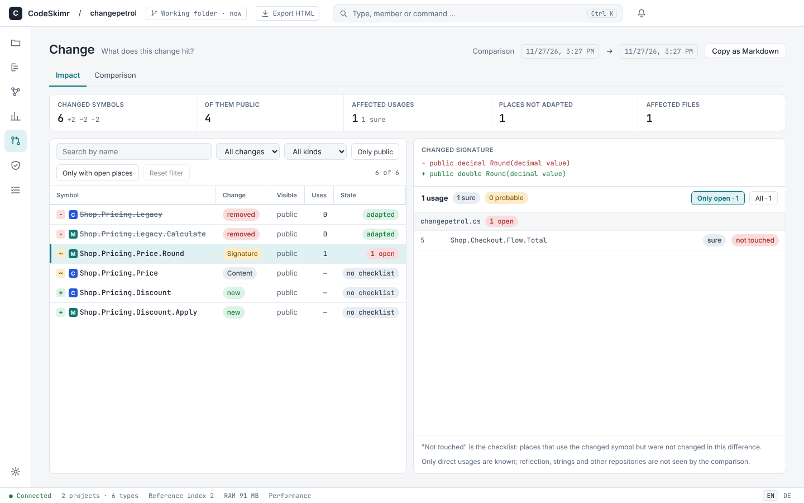
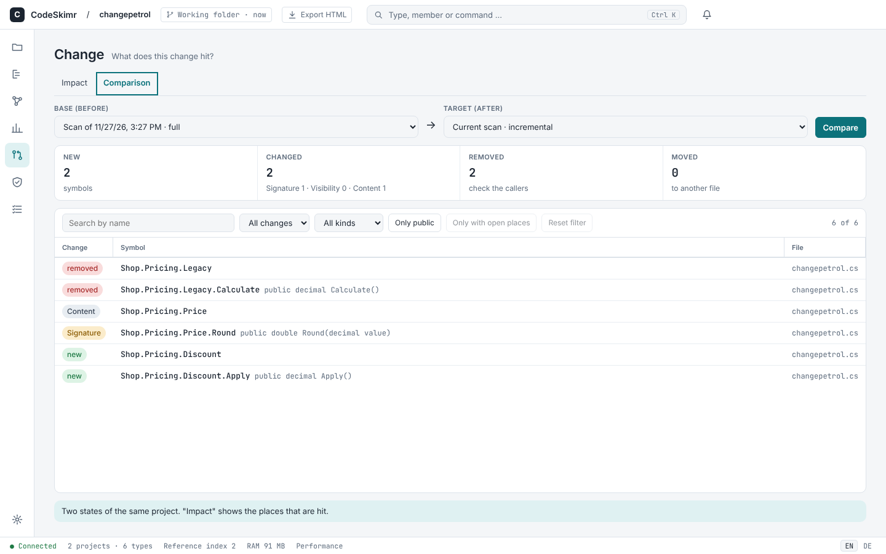

# Änderung

Die Ansicht „Änderung“ vergleicht zwei Scans des geöffneten Projekts und zeigt, was der Unterschied trifft. Sie beantwortet die Frage „Was bricht, wenn ich das übernehme?“. Der Eintrag in der Navigationsleiste ist verfügbar, sobald ein Projekt geöffnet ist.

## Welche Scans verglichen werden

CodeSkimr bewahrt die letzten Scans eines Projekts auf (standardmäßig fünf). Jeder Scan ist ein eigener Eintrag; ein Scan ohne Änderung steht mit „0 geändert“ da. Die Ansicht vergleicht den neuesten Scan mit dem davor; hat sich dazwischen nichts geändert, sagt sie das. Im Reiter „Vergleich“ lassen sich zwei beliebige aufbewahrte Scans wählen: Die Basis ist der ältere, das Ziel der neuere. Das Projekt braucht mindestens zwei Scans.

Der Reiter „Scan“ der Projektseite listet die aufbewahrten Scans. Der Knopf „Mit aktuellem vergleichen“ in einer Zeile öffnet diese Ansicht mit diesem Scan als Basis und dem neuesten als Ziel.

## Auswirkung

Fünf Kennzahlen: die geänderten Symbole (neu, geändert, entfernt), wie viele davon öffentlich sind, die Verwendungen, die sie treffen, die nicht angepassten Stellen und die Dateien, die sie enthalten. Die Tabelle listet jedes entfernte, geänderte oder neue Symbol mit der Art der Änderung, der Sichtbarkeit und dem Zustand seiner Verwendungen: „n offen“ oder „angepasst“. Wer eine Zeile wählt, mit der Maus oder den Pfeiltasten, sieht rechts, was sich geändert hat (die alte und die neue Signatur) und die direkten Verwendungen des Symbols, nach Datei gruppiert, mit der Sicherheit des Index („sicher“ oder „wahrscheinlich“).

Eine Verwendung ist „angepasst“, wenn das Symbol, das sie enthält, im selben Unterschied selbst geändert, verschoben oder entfernt wurde, sonst „nicht angefasst“. **Die nicht angefassten Verwendungen sind die Prüfliste**: Stellen, die das geänderte Symbol verwenden, aber nicht geändert wurden. „Nur offene“ zeigt genau diese, „Alle“ jede Verwendung. Ein Symbol, dessen Inhalt sich geändert hat, und ein neues Symbol haben keine Prüfliste, weil ihre Verwendungen durch diese Änderung nicht brechen können.

**Lange Listen.** Die Tabelle und die Spalte rechts nutzen die Höhe bis zum unteren Fensterrand und haben je eine eigene Bildlaufleiste; Überschrift, Kennzahlen und Reiter bleiben stehen. Der Tabellenkopf bleibt oben, während die Zeilen scrollen.

**Sortieren und Breiten.** Ein Klick auf einen Spaltenkopf sortiert die Liste nach dieser Spalte; ein zweiter dreht die Reihenfolge um, ein dritter nimmt die Sortierung zurück, die Zeilen folgen dann wieder der Reihenfolge der Antwort (`aria-sort` am Kopf, eine Markierung neben dem Namen). Texte sortieren ohne Rücksicht auf Groß- und Kleinschreibung und mit Ziffern nach ihrem Wert; Zahlen beginnen mit der größten; eine Zeile ohne Wert bleibt am Ende. Die Sortierung wirkt auf die Zeilen, die den Filter passieren, und das gewählte Symbol bleibt gewählt. Jede Spalte hat am rechten Rand einen Griff für ihre Breite (Pfeiltasten, wenn er den Fokus hat, `Pos1` oder Doppelklick für die ersten Breiten); die Breiten merkt sich der Browser. Beide Listen haben das.

**Filter.** Die Zeile über der Tabelle grenzt die Liste ein: eine Suche im qualifizierten Namen (irgendwo im Namen, Groß- und Kleinschreibung egal), die Art der Änderung (neu, geändert, entfernt, verschoben), die Art des Symbols (der Buchstabe des Abzeichens und die Art, etwa `M · method`), „Nur öffentliche“ und „Nur mit offenen Stellen“ (Symbole mit nicht angefassten Stellen). „Filter zurücksetzen“ nimmt alle Auswahlen zurück. Die Zahl sagt, wie viele Zeilen durchkommen: „123 von 2.305“. Wurde die Antwort auf `compare.max_symbols` gekürzt, steht dort „123 von 780 aufgelisteten (2.305 insgesamt)“: Der Filter wirkt nur auf die aufgelisteten Symbole. Wird das gewählte Symbol ausgefiltert, springt die Auswahl auf das erste, das übrig bleibt; bleibt keines übrig, sagt die Liste das und die Spalte rechts bleibt leer. Der Filter ist mit der Tastatur bedienbar: `Tab` erreicht Felder und Knöpfe, `Leertaste` oder `Eingabe` drücken einen Knopf, die Pfeiltasten in der Tabelle wählen eine Zeile.

Unter der Tabelle nennt die Ansicht neue Schichtverstöße und neue Schichtzyklen (Abhängigkeiten zwischen Schichten, die der Ziel-Scan hat und der Basis-Scan nicht hatte) sowie die kritischen Symbole, die der Unterschied berührt.

Der Knopf „Als Markdown kopieren“ oben rechts kopiert die Auswirkung als Text für einen Kommentar zu einem Pull Request: die Zahlen, die Prüfliste der nicht angefassten Stellen, neue Schichtverstöße und Zyklen. Es ist der Text, den `codeskimr change --markdown` ausgibt, in der Sprache der Ansicht. Der Knopf meldet „Kopiert“ oder „Nicht kopiert“, wenn der Browser die Zwischenablage verweigert.

Bekannt sind nur direkte Verwendungen. Aufrufe über Reflection, in Zeichenketten oder aus anderen Repositories sieht der Vergleich nicht; die Ansicht sagt das. Wurde eine Liste auf ihre Grenze gekürzt (`compare.max_symbols`, `compare.max_usages` in der Konfiguration), sagt eine Zeile es.

## Vergleich

Die beiden Auswahlfelder wählen die Scans; „Vergleichen“ liest den Vergleich neu. Die vier Zahlen zählen die neuen, geänderten, entfernten und verschobenen Symbole. Die Liste zeigt jedes Symbol mit dem Grund (Signatur, Sichtbarkeit oder Inhalt; ein verschobenes Symbol zeigt seine alte und neue Datei). Zwei Symbole sind dasselbe Symbol, wenn Art, qualifizierter Name und Parametertypen gleich sind; ein umbenanntes Symbol erscheint deshalb als entfernt und neu.

Die Liste hat dieselbe Filterzeile, mit ausgegrautem „Nur mit offenen Stellen“, das ein Tooltip erklärt (der Vergleich hat keine Prüfliste), und dieselbe Bildlaufleiste. Ein Name oder eine Signatur, die breiter ist als die Liste, wird mit Auslassungspunkten gekürzt; der Tooltip zeigt den ganzen Text.

## Auf der Kommandozeile

Dieselbe Antwort gibt es als `codeskimr scans`, `codeskimr compare` und `codeskimr change` (mit `--markdown` für einen Kommentar zu einem Pull Request; dafür hat die Ansicht den Knopf „Als Markdown kopieren“) und für Agenten als MCP-Werkzeug `impact_of_diff`. Der Filter der Ansicht wirkt auf die Antwort, die die Ansicht hält; das Gegenstück auf der Konsole ist `--json` mit einem Filter darauf, etwa `codeskimr change --json | jq '.impact.items[] | select(.symbol.visibility == "public" and .not_touched > 0) | .symbol.qualified_name'` (siehe [Kommandozeile](../../cli.md)). Siehe die Referenzen zur [Kommandozeile](../../cli.md) und zum [Vergleich](../../compare.md).

## Tasten

| Taste | Aktion |
|---|---|
| `←` `→` auf einem Reiter | vorheriger oder nächster Reiter |
| `↑` `↓`, `Pos1`, `Ende` in der Tabelle | vorheriges oder nächstes Symbol, erstes oder letztes wählen |
