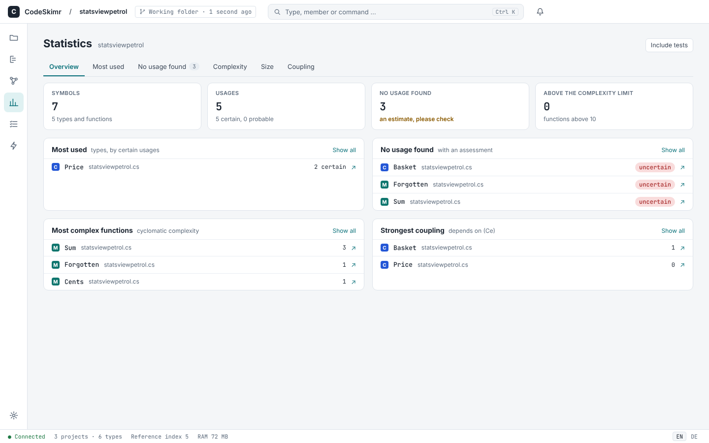

# Statistik

Die Statistik stellt die Symbole des geöffneten Projekts in Ranglisten: welche am meisten verwendet werden, für welche keine Verwendung gefunden wurde, welche Funktionen am komplexesten, am größten und am stärksten gekoppelt sind. Der Eintrag in der Navigationsleiste ist verfügbar, sobald ein Projekt geöffnet ist.

## Übersicht

Vier Kennzahlen (Symbole, Verwendungen, Symbole ohne Verwendung, Funktionen über dem Komplexitäts-Grenzwert) und vier Karten mit den ersten fünf Zeilen einer Rangliste. Ein Klick auf eine Zeile öffnet das Symbol im Explorer; „Alle ansehen“ öffnet die ganze Rangliste.

## Die Ranglisten

| Reiter | Zeigt | Sortiert nach |
|---|---|---|
| Meist verwendet | Typen und Funktionen, die andere verwenden | sicheren Verwendungen (oder allen, der Obergrenze) |
| Ohne Verwendung | Symbole, für die der Scan keine Verwendung gefunden hat | Datei und Name |
| Komplexität | Funktionen und Methoden | zyklomatischer Komplexität |
| Größe | Typen und Funktionen | Codezeilen |
| Kopplung | Typen | Zahl der anderen, von denen sie abhängen (Ce) |

Filter: Art (alle, Typen, Funktionen) und Sprache. Wählen Sie eine Zeile, zeigt die Spalte rechts ihre Zahlen. `Enter` oder ein Doppelklick öffnet das Symbol im Explorer, `U` zeigt seine Verwendungen, die Pfeiltasten bewegen die Auswahl.

„Tests einbeziehen“ oben rechts zählt auch Testcode. Es ist standardmäßig aus, weil Testfunktionen vom Testprogramm aufgerufen werden und von niemandem sonst: Sie würden die Liste der Symbole ohne Verwendung füllen.

## Sicher und „bis“

Verwendungen sind immer zwei Zahlen, zum Beispiel „28 sicher, bis 73“. Stufe 1 liest den Quelltext. Eine Verwendung ist sicher, wenn der Name zweifelsfrei aufgelöst werden konnte. Die anderen sind wahrscheinlich: Sie können zu einem gleichnamigen Symbol gehören. Die zweite Zahl ist deshalb eine Obergrenze. Mit Stufe 2 (siehe [Sprach-Indexer](indexer.md)) bestätigt der Compiler die Verwendungen, und die beiden Zahlen rücken zusammen.

Gezählt werden nur direkte Verwendungen. Verwendungen aus Testcode und eines Symbols durch sich selbst zählen nicht.

## „Ohne Verwendung“ heißt nicht toter Code

Der Scan sieht keine Aufrufe über Makros oder Reflection, keine Einstiegspunkte, die ein Framework oder das Betriebssystem aufruft (`main`, Handler), und keine Verwender in anderen Projekten. Jede Zeile hat deshalb eine Einschätzung:

- **sehr wahrscheinlich ungenutzt**: nicht öffentlich, in einer Sprache mit genauen Verwendungen. Hier lohnt der erste Blick.
- **öffentlich**: kann von außerhalb des Projekts verwendet werden.
- **unsicher**: Die Verwendungen dieser Sprache sind eine Näherung (Python, C#, Kotlin).

Prüfen Sie, bevor Sie löschen.

## Komplexität

Das Histogramm zeigt, wie viele Funktionen welche Komplexität haben; die Balken über dem Grenzwert (standardmäßig 10, `metrics.cyclomatic_medium_max`) sind markiert. Das Bild „Hotspots“ stellt die komplexesten Funktionen ihren Verwendungen gegenüber: Eine Funktion oben rechts ist komplex und viel verwendet, eine Änderung dort ist riskant. Der Punkt steht bei den sicheren Verwendungen, der Strich reicht bis zur Obergrenze.
