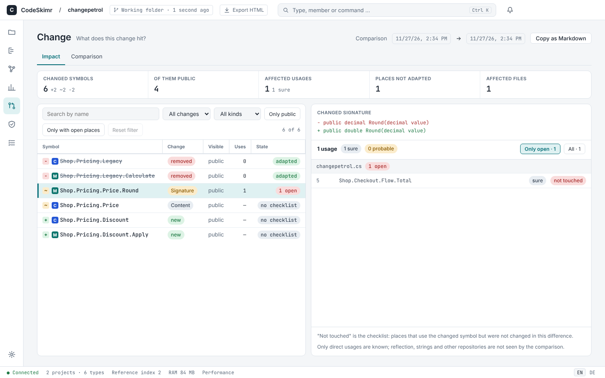
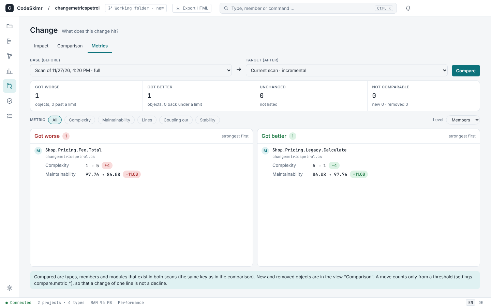

# Change

The screen "Change" compares two scans of the open project and shows what the difference hits. It is the screen behind the question "what breaks if I merge this?". The entry in the navigation rail is available as soon as a project is open.

## Which scans are compared

CodeSkimr keeps the last scans of a project (five by default). Every scan is an entry of its own; a scan that found nothing changed shows "0 changed". The screen compares the newest scan with the one before it; if nothing changed between them, it says so. In the tab "Comparison" you can pick any two kept scans: the base is the older one, the target the newer one. The project needs at least two scans.

The tab "Scan" of the project page lists the kept scans. The button "Compare with current" in a row opens this screen with that scan as the base and the newest scan as the target.

## Impact

Five figures: the changed symbols (new, changed, removed), how many of them are public, the usages they hit, the places not adapted and the files that hold them. The table lists every removed, changed or new symbol with the kind of change, its visibility and the state of its usages: "n open" or "adapted". Select a row, with the mouse or with the arrow keys, and the panel at the right shows what changed (the old and the new signature, with the syntax colours of the language as in the explorer, a sign in front, tinted red or green) and the direct usages of the symbol, grouped by file, with how sure the index is ("sure" or "probable").

A usage is "adapted" when the symbol that holds it is itself changed, moved or removed in the same difference, and "not touched" otherwise. **The usages that were not touched are the checklist**: places that use the changed symbol but were not changed. "Only open" shows just those; "All" shows every usage. A symbol whose content changed, and a new symbol, have no checklist, because their usages cannot break by this change.

**Long lists.** The table and the panel at the right use the height down to the bottom of the window and each has a scrollbar of its own; the heading, the figures and the tabs stay in place. The head of the table stays at the top while the rows scroll.

**Sorting and widths.** A press on a column head sorts the list by that column; a second press turns the order round and a third press removes the sort, so the rows follow the order of the answer again (`aria-sort` on the head, a mark next to its name). Texts sort without regard to case and with digits by value; numbers start with the largest first; a row without a value stays last. The sort works on the rows that pass the filter, and the selected symbol stays selected. Every column has a handle on its right edge for its width (arrow keys when it has the focus, `Home` or a double click for the first widths); the widths are kept in the browser. Both lists have this.

**Filter.** The row over the table narrows the list: a search in the qualified name (anywhere in the name, case does not matter), the kind of change (new, changed, removed, moved), the kind of symbol (the letter of the badge and the kind, such as `M · method`), "Only public" and "Only with open places" (symbols that have places not touched). "Reset filter" takes all choices back. The count says how many rows pass: "123 of 2,305". The filter is applied on the server before the lists are cut to `compare.max_symbols` (a short pause after the last change, so typing does not ask for every letter), so a search finds every hit, and the count says how many symbols pass. If even the hits are more than `compare.max_symbols`, the count says "123 of 780 listed (2,305 in all)". If the selected symbol is filtered out, the selection moves to the first symbol that is left; if none is left, the list says so and the panel stays empty. The filter works with the keyboard: `Tab` reaches the fields and buttons, `Space` or `Enter` press a button, the arrow keys in the table select a row.

Under the table the screen names new layer violations and new layer cycles (dependencies between layers that the target scan has and the base scan did not have) and the critical symbols the difference touches.

The button "Copy as Markdown" at the top right copies the impact as text for a comment on a pull request: the numbers, the checklist of the places not touched, new layer violations and cycles. It is the text `codeskimr change --markdown` prints, in the language of the screen. The button says "Copied", or "Not copied" if the browser refuses the clipboard.

Only direct usages are known. Calls by reflection, in strings or from other repositories are not seen; the screen says so. If a list was cut to its limit (`compare.max_symbols`, `compare.max_usages` in the configuration), a line says so.

## Comparison

The two selectors choose the scans; "Compare" reads the comparison again. The four figures count the new, changed, removed and moved symbols. The list shows each symbol with the reason (signature, visibility or content; a moved symbol shows its old and new file). A symbol is the same symbol when kind, qualified name and parameter types are equal; a renamed symbol therefore shows as removed and new.

The list has the same filter row, with "Only with open places" greyed out and explained by a tooltip (the comparison has no checklist), and the same scrollbar. A name or signature that is wider than the list is cut with an ellipsis; the tooltip shows the full text.

## Metrics

The tab "Metrics" answers a second question with the same two scans: which objects got worse by their metrics and which got better. It looks at objects that exist in both scans (the same key as in the comparison); new and removed objects stay in the tab "Comparison". The four figures count the objects that got worse, the ones that got better, the ones that did not move and the ones that cannot be compared (new and removed).

A metric counts as moved only from a threshold, so that a change of one line is not a decline: complexity from 2, maintainability index from 5 points, coupling out from 2, stability from 100 per mille, and lines only when the object grew by 20 or more (settings `compare.metric_*`). A move that crosses the bound of the rating (for example complexity from "ok" to "poor") is marked "past the limit" or "back under the limit" and ranks first. An object can be on both sides, when one of its metrics got worse and another got better.

The chips narrow both lists to one metric. The level chooses what is compared: members (lines, complexity, maintainability), types (and coupling out and stability) or modules (coupling and stability). Coupling and stability do not exist for members; their chips are greyed out with a tooltip, and a metric that was chosen is reset to "All" when you change the level.

Each list is a table with the columns Object, File, Metric, From → to and Change, one row per moved metric. It is sorted the way the answer is (the strongest move first) until you press a column head; the sort and the handles for the widths work as in the tab "Impact". The head of a list says how many of the objects are listed ("12 of 12", or "30 of 30 listed (212 in all)" if the answer was cut).

The button "Copy as Markdown" copies the lists as text for a comment on a pull request, for the chosen level and metric. Without an answer it is greyed out and says why. It is the text `codeskimr compare --metrics --markdown` prints.

## On the command line

The same answer is available as `codeskimr scans`, `codeskimr compare` (with `--metrics` for the tab "Metrics"), `codeskimr compare --metrics --markdown` and `codeskimr change` (with `--markdown` for a comment on a pull request; the screen has the button "Copy as Markdown" for the same text), and to agents as the MCP tool `impact_of_diff`. The filter of the screen is applied on the server before the lists are cut, so a search finds every hit even if the answer lists only the first symbols of a very large difference; the console has the same filter, for example `codeskimr change --match Price --cause removed --public --only-open` (see the [command line](../../cli.md)). See the [command line](../../cli.md) and [comparison](../../compare.md) references.

## Keys

| Key | Action |
|---|---|
| `←` `→` on a tab | the previous or next tab |
| `↑` `↓`, `Home`, `End` in the table | select the previous or next symbol, the first or the last |
