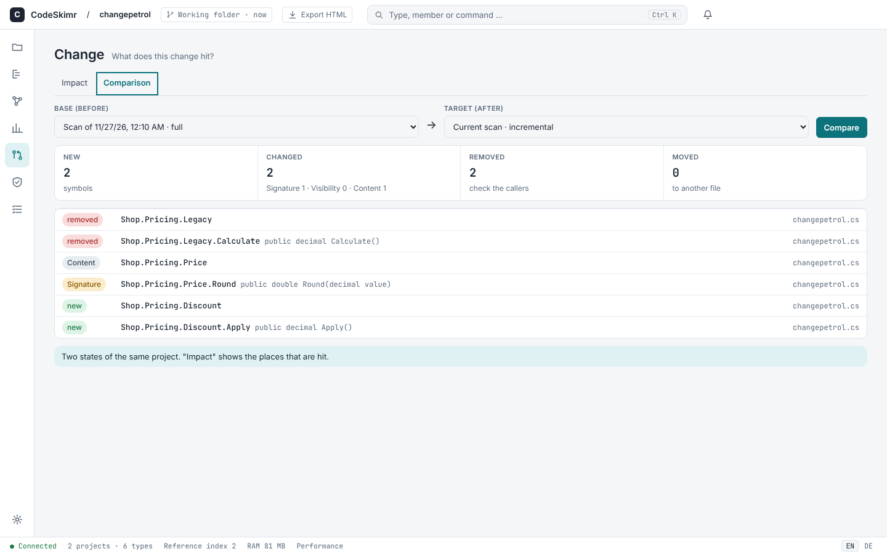

# Change

The screen "Change" compares two scans of the open project and shows what the difference hits. It is the screen behind the question "what breaks if I merge this?". The entry in the navigation rail is available as soon as a project is open.

## Which scans are compared

CodeSkimr keeps the last scans of a project (five by default). A scan without changes writes no entry, so every kept scan is one that changed something. The screen compares the newest scan with the one before it. In the tab "Comparison" you can pick any two kept scans: the base is the older one, the target the newer one. The project needs at least two scans.

The tab "Scan" of the project page lists the kept scans. The button "Compare with current" in a row opens this screen with that scan as the base and the newest scan as the target.

## Impact

Five figures: the changed symbols (new, changed, removed), how many of them are public, the usages they hit, the places not adapted and the files that hold them. The table lists every removed, changed or new symbol with the kind of change, its visibility and the state of its usages: "n open" or "adapted". Select a row, with the mouse or with the arrow keys, and the panel at the right shows what changed (the old and the new signature) and the direct usages of the symbol, grouped by file, with how sure the index is ("sure" or "probable").

A usage is "adapted" when the symbol that holds it is itself changed, moved or removed in the same difference, and "not touched" otherwise. **The usages that were not touched are the checklist**: places that use the changed symbol but were not changed. "Only open" shows just those; "All" shows every usage. A symbol whose content changed, and a new symbol, have no checklist, because their usages cannot break by this change.

Under the table the screen names new layer violations and new layer cycles (dependencies between layers that the target scan has and the base scan did not have) and the critical symbols the difference touches.

Only direct usages are known. Calls by reflection, in strings or from other repositories are not seen; the screen says so. If a list was cut to its limit (`compare.max_symbols`, `compare.max_usages` in the configuration), a line says so.

## Comparison

The two selectors choose the scans; "Compare" reads the comparison again. The four figures count the new, changed, removed and moved symbols. The list shows each symbol with the reason (signature, visibility or content; a moved symbol shows its old and new file). A symbol is the same symbol when kind, qualified name and parameter types are equal; a renamed symbol therefore shows as removed and new.

## On the command line

The same answer is available as `codeskimr scans`, `codeskimr compare` and `codeskimr change` (with `--markdown` for a comment on a pull request), and to agents as the MCP tool `impact_of_diff`. See the [command line](../../cli.md) and [comparison](../../compare.md) references.

## Keys

| Key | Action |
|---|---|
| `←` `→` on a tab | the previous or next tab |
| `↑` `↓`, `Home`, `End` in the table | select the previous or next symbol, the first or the last |
