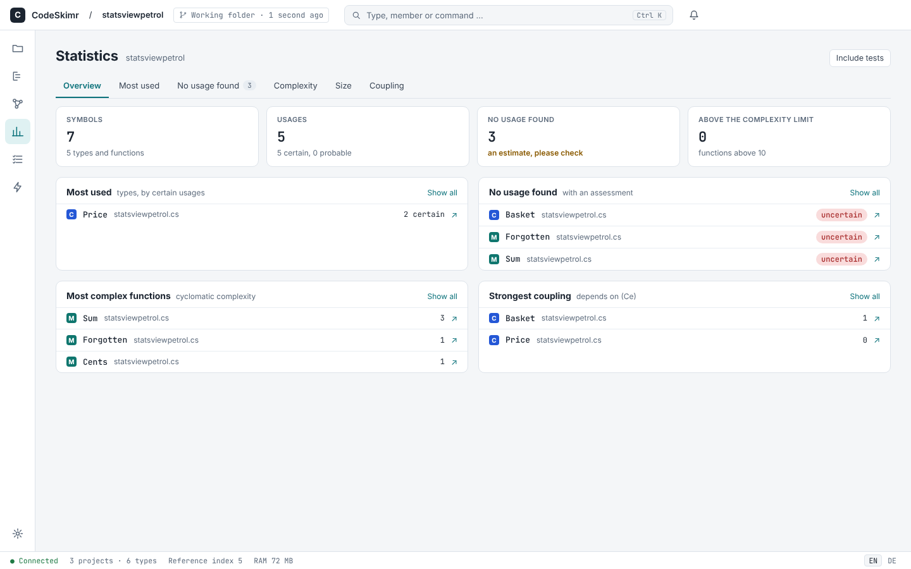

# Statistics

The statistics rank the symbols of the open project: which are used most, for which no usage was found, which functions are the most complex, the largest and the most coupled. The entry in the navigation rail is available as soon as a project is open.



## Overview

Four numbers (symbols, usages, symbols without a usage, functions above the complexity limit) and four cards with the first five rows of a ranking. A click on a row opens the symbol in the explorer; "Show all" opens the full ranking.

## The rankings

| Tab | Shows | Sorted by |
|---|---|---|
| Most used | types and functions that others use | certain usages (or all, the upper bound) |
| No usage found | symbols for which the scan found no usage | assessment, then file and name |
| Complexity | functions and methods | cyclomatic complexity |
| Size | types and functions | lines of code |
| Coupling | types and functions that have the value (in practice types) | how many others they depend on (Ce) |

Filters: kind (all, types, functions; not on the complexity tab, which holds functions only) and language. "Show all" on a card of types opens the ranking cut to types. Select a row and the panel at the right shows its numbers. `Enter` or a double click opens the symbol in the explorer, `U` shows its usages, the arrow keys move the selection.

"Include tests" at the top right counts test code as well. It is off by default, because the test runner calls test functions and nobody else does: they would fill the list of unused symbols.

## Certain and "up to"

Usages are always two numbers, for example "28 certain, up to 73". Level 1 reads the source text. A usage is certain if the name could be resolved without doubt. The others are probable: they may belong to another symbol with the same name. The second number is therefore an upper bound. With level 2 (see [Language indexers](indexers.md)) the compiler confirms the usages and the two numbers move together.

Only direct usages are counted. Usages from test files and of a symbol by itself are not. Calls from a test module inside a production file (for example `mod tests` in Rust) still count as usages.

## "No usage found" does not mean dead code

The scan does not see calls through macros or reflection, entry points that a framework or the operating system calls (`main`, handlers), and users in other projects. Every row therefore has an assessment:

- **very likely unused**: not public, in a language with exact usages. Worth a look first.
- **public**: may be used from outside the project.
- **uncertain**: the usages of this language are an approximation (Python, C#, Kotlin).

Constructors and members that override or implement another member are not listed at all: they are called through their type or through the member they stand in for, which the count of direct usages cannot show.

Next to the assessment each row shows its **reason**, for example "private, no usage in its class or file" or "public: users outside the project are possible".

Check before you delete.

### Keeping symbols on purpose (exception list)

The button "Keep on purpose" in a row asks for a reason and writes the symbol into the exception list; "Lift" in the group "Left out" takes the entry out again. The button writes an entry with the qualified name and the reason, followed by the date, so that the list reads like a record. A symbol whose name holds `*` or `?` cannot be kept by button (the entry would cover more); write such an entry by hand. What should stay can also go into the `.codeskimr.toml` of the project directly, so that the whole team sees the same:

```toml
[[unused.ignore]]
paths = ["Data/Migrations/**"]
reason = "called by the migration tool"

[[unused.ignore]]
symbols = ["*.DesignTimeFactory"]
reason = "only for dotnet ef"
```

`paths` are patterns on the file path, `symbols` patterns on the qualified name (`*` stands for any run of characters, `?` for exactly one). If an entry has both lists, both must match. The reason is mandatory. Such symbols are no longer in the number and the list; they stand below, in the group "Left out", with the rule to look at. This holds for folder projects; a Git project has no project file.

## Complexity

The histogram shows how many functions have each complexity; the bars above the limit (10 by default, `metrics.cyclomatic_medium_max`) are marked. The picture "Hotspots" puts the most complex functions against their usages: a function at the upper right is complex and much used, so a change there is risky. The dot stands at the certain usages, the line reaches up to the upper bound.
